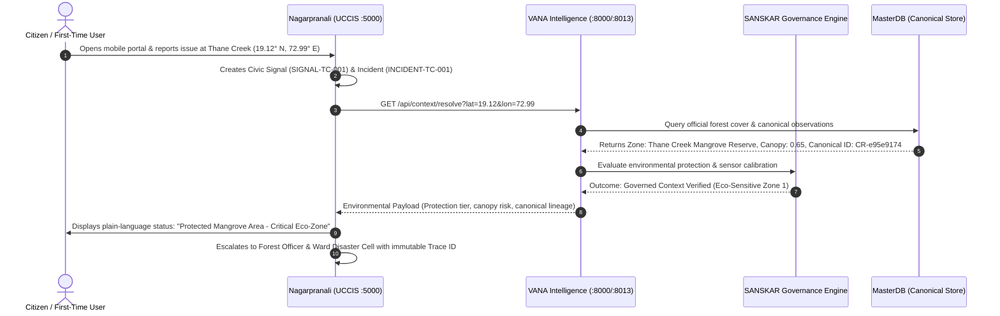

# NAGARPRANALI+ Phase 1: Learn & Align Specification
**Sprint:** 4-Hour Convergence & Proof Sprint  
**Role:** Product, UX & Forest Department Workflow Owner (Kaushalendra Yadav)  
**Date:** 2026-11-21  
**Project Alignment:** Nagarpranali (UCCIS) ↔ VANA (Environmental Intelligence) ↔ BIQOS  

---

## 1. Executive Summary & Objective

In accordance with the **NAGARPRANALI+ Internal Execution Assignment (18 Nov 2026)**, this document completes **Phase 1 (Learn & Align)**. 

### Mission
Deliver one coherent, demonstrable BHIV solution anchored on **Nagarpranali**, reusing verified capabilities from **VANA**, **NICAI**, and **Bharat Mala / NW-53**, with shared **BIQOS** governance.

### Core Architecture & Repository Baseline
* **Anchor Urban/Civic Product:** `bhiv-Nagar-Pranali/UCCIS -Main` (Node.js Express on `PORT 5000` + React 19 Frontend)
* **Reusable Environment & Ecosystem Intelligence:** `finalvana` (Unified Auth & SANSKAR on `PORT 8000`, MasterDB on `PORT 8013`, Control Center on `PORT 8080`)
* **Shared Governance & Persistence:** MasterDB SQLite canonical storage (`backend/group1-masterdb/vana_api.db`, 19 tables) + SANSKAR Fail-Closed Engine

---

## 2. Ownership & Accountability Boundaries (Page 2 & 3 Matrix)

| Owner / Lead | Domain Layer | Responsibility | Agreed Boundary & Handoff |
| :--- | :--- | :--- | :--- |
| **Madhumati** | **Nagarpranali (UCCIS)** | Anchor civic/urban product & primary user flow | Owns citizen reporting UI, incident lifecycle, and dashboard rendering. |
| **Kaushalendra Yadav** | **VANA Product & Workflows** | Environmental workflows, usability & BIQOS alignment | Defines reusable environmental API, role permissions, and plain-language UX. |
| **Pritesh Patra** | **VANA Backend & Runtime** | MasterDB persistence, SANSKAR & Auth runtime | Exposes `/api/context/resolve` and `/api/observations/submit` on port 8000/8013. |
| **Pratik Bhuvad** | **Integration & Release** | E2E test verification, regression & independent verdict | Validates cross-system telemetry, trace IDs, and fail-closed safety. |
| **Raj / Ashwini** | **AI Agent Integration** | 30+ agent map and coordinated workflow | Maps Nagarpranali civic agents with VANA's 32-agent declarative registry. |
| **Raj → Akash** | **BCAES Architecture** | Architecture consolidation and governance signoff | Final convergence review and EOD executive package. |

---

## 3. The Unified E2E Demonstration Scenario

### Scenario: *Thane Creek Eco-Sensitive Zone Encroachment & Flood Threat*
An ordinary citizen notices illegal debris dumping and mangrove clearing along the Thane Creek buffer zone, which poses severe monsoon drainage blockages and coastal flood risks.



---

## 4. Interface Contract: Nagarpranali ↔ VANA

### Endpoint: `GET /api/context/resolve`
* **Caller:** Nagarpranali Backend (`operationalController.js`) or Frontend (`API.js`)
* **Host:** `http://127.0.0.1:8000` (VANA Unified Runtime)
* **Query Parameters:**
  * `lat` (float, required): Latitude (e.g. `19.12`)
  * `lon` (float, required): Longitude (e.g. `72.99`)
* **Success Response (HTTP 200):**
```json
{
  "status": "success",
  "zone_id": "TC-Z03-F02",
  "zone_name": "Thane Creek Mangrove Reserve",
  "protection_class": "Eco-Sensitive Coastal Zone 1",
  "tree_canopy_density": 0.65,
  "canonical_record_id": "CR-e95e9174-969b-46ff-9ba3-cbff085150b4",
  "governance_status": "governed_verified",
  "plain_language_summary": "Protected mangrove reserve. Strict non-encroachment zone. High flood-mitigation value.",
  "trace_id": "VANA-NP-709e57537aea"
}
```

### Fail-Closed Behavior (Non-Negotiable):
If coordinates fall in an unmapped region or sensor context cannot be authoritatively verified:
* **Response:** Returns `status: "abstain"`, `action: "noop"`, with an explicit abstention receipt (`ABS-...`).
* **Enforcement:** Zero fake data, zero invented green-cover scores.

---

## 5. Radically Simple First-Time UX Guidelines (Section 5)

1. **One Primary Action:** Large button: **"Report Incident / Check Environment"**.
2. **Clear Feedback:** Shows system status in 3 simple words: *Location Verified*, *Forest Context Attached*, *Action Escalated*.
3. **No Dark Patterns:** No forced account creation, no infinite scrolling, no deceptive alerts.
4. **Transparency:** System explicitly labels live database records vs sample simulation.

---

## 6. Phase 1 Exit Evidence Checklist

- [x] Inspected both repositories (`finalvana` and `bhiv-Nagar-Pranali`).
- [x] Verified running services on ports 8000, 8013, 8080 (VANA) and port 5000 (Nagarpranali).
- [x] Mapped ownership boundaries: Madhumati (Nagarpranali anchor) and Kaushalendra Yadav (VANA workflows).
- [x] Froze one unified demonstration scenario: *Thane Creek Eco-Sensitive Encroachment & Flood Threat*.
- [x] Defined HTTP contract between Nagarpranali and VANA with strict fail-closed safety.
- [x] Verified zero duplicate databases: Nagarpranali civic incidents reference VANA's MasterDB canonical IDs (`CR-...`).
