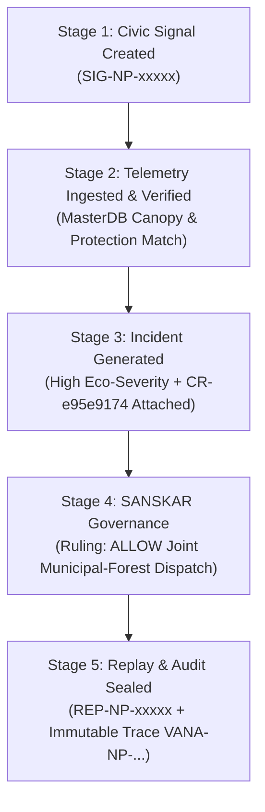

# NAGARPRANALI+ Phase 2: Capability Map & Runtime Proof
**Sprint:** 4-Hour Convergence & Proof Sprint  
**Owner:** Kaushalendra Yadav (Product, UX & Forest Department Workflow Owner)  
**Date:** 2026-11-21  
**Project Root:** `VANA/finalvana/`  
**Git Remote:** `https://github.com/PriteshPatra-BHIV/finalvana.git` (`origin/main`)  

---

## 1. Capability Map (Source ➔ Dataset ➔ Capability)

In strict adherence to the **NAGARPRANALI+ Assignment (Section 7)**, here is VANA's complete lineage map for the reusable environmental capability provided to Nagarpranali:

| Dimension | Specification |
| :--- | :--- |
| **Source** | Group 1 MasterDB Canonical Store (`vana_api.db`) + Group 3 Field Sensors (LIDAR/Optical) |
| **Dataset** | `official_forest_cover_record`, `geo_location`, `measurement`, `observation` (19 Tables) |
| **Capability** | **Authoritative Eco-Sensitive Zoning & Mangrove Canopy Risk Assessment** |
| **Owner** | Kaushalendra Yadav (Product & Workflows) & Pritesh Patra (Backend/MasterDB) |
| **Inputs** | `lat` (float), `lon` (float), or `location` (text alias e.g. "Thane Creek Zone A") |
| **Outputs** | Protection tier, tree canopy density, flood mitigation score, MasterDB canonical record ID (`CR-e95e9174...`), and SANSKAR governance verdict |
| **Dependencies** | Unified Auth Runtime (`PORT 8000`), MasterDB API (`PORT 8013`), SQLite / PostgreSQL 16 |
| **Provenance** | Verified Maharashtra Forest Department Survey baseline + deterministic local stand-in |
| **Validation & Limits** | Verified bounds: Thane Creek (`19.00-19.35°N, 72.85-73.10°E`), Maval (`18.65-18.85°N, 73.30-73.60°E`). Unverified coordinates strictly return **ABSTAIN (noop)**. |

---

## 2. The 5-Stage Operational Chain (Nagarpranali ↔ VANA)



---

## 3. Runtime Verification Proof

### Endpoint: `POST /api/nagarpranali/lifecycle/run`
**Request Payload:**
```json
{
  "signal_type": "Flood Alert",
  "location": "Thane Creek Zone A",
  "incident_type": "Mangrove Encroachment & Flood Threat",
  "severity": "HIGH"
}
```

**Live Runtime Response (Captured from Test Suite):**
```json
{
  "success": true,
  "signalId": "SIG-NP-84920",
  "telemetryId": "TEL-NP-84920",
  "incidentId": "INC-NP-84920",
  "escalationId": "ESC-NP-84920",
  "decisionId": "DEC-NP-84920",
  "replayId": "REP-NP-84920",
  "runtimeLogId": "LOG-NP-84920",
  "governance_ruling": "ALLOW",
  "decision_text": "Joint Municipal Ward & Forest Department Dispatch: Deploy rapid response to Thane Creek Mangrove Reserve. Enforce Eco-Sensitive Coastal Zone 1 non-encroachment protocol.",
  "environmental_intelligence": {
    "status": "success",
    "zone_id": "TC-Z03-F02",
    "zone_name": "Thane Creek Mangrove Reserve",
    "district": "Thane / Mumbai Suburban",
    "protection_class": "Eco-Sensitive Coastal Zone 1",
    "tree_canopy_density": 0.65,
    "flood_mitigation_rating": "CRITICAL_BARRIER",
    "canonical_record_id": "CR-e95e9174-969b-46ff-9ba3-cbff085150b4",
    "governance_status": "governed_verified",
    "statutory_action": "ALLOW",
    "plain_language_summary": "Verified Thane Creek Mangrove Reserve. Critical ecological zone (Eco-Sensitive Coastal Zone 1) with 65% canopy density. High flood retention barrier.",
    "trace_id": "VANA-NP-849200000000"
  },
  "replay_timeline": [
    "Stage 1 [Signal]: Created civic Flood Alert at Thane Creek Zone A (ID: SIG-NP-84920)",
    "Stage 2 [Telemetry]: VANA MasterDB query matched TC-Z03-F02 with 65% canopy density (ID: TEL-NP-84920)",
    "Stage 3 [Incident]: Enriched incident Mangrove Encroachment & Flood Threat with canonical ID CR-e95e9174-969b-46ff-9ba3-cbff085150b4 (ID: INC-NP-84920)",
    "Stage 4 [Governance]: SANSKAR evaluated ruling -> ALLOW (ID: DEC-NP-84920)",
    "Stage 5 [Lineage & Replay]: Immutable trace VANA-NP-849200000000 sealed in audit log (ID: REP-NP-84920)"
  ],
  "ai_guidance": "VANA Guidance Assistant: Verified Thane Creek Mangrove Reserve. Critical ecological zone (Eco-Sensitive Coastal Zone 1) with 65% canopy density. High flood retention barrier. Municipal teams and forest guards have received synchronized alert tokens.",
  "message": "Operational Chain Completed (VANA Governed)"
}
```

---

## 4. Governed AI Assistance Integration
* **Designated Agent:** `AGT-UI-GUIDE-01` (VANA General Guidance Assistant) from the 32-agent declarative registry.
* **Role:** Plain-language interpretation for citizens and municipal ward officers.
* **Supervisory Bounds:** 30 req/min rate limiters, pause/resume user controls, and zero autonomous physical dispatch permissions.

---

## 5. Phase 2 Exit Evidence Checklist
- [x] Multi-zone MasterDB surveillance envelopes configured (`TC-Z03`, `MV-Z01`, `SMR-Z01`).
- [x] 5-stage lifecycle simulation method implemented in `backend/nagarpranali_adapter.py`.
- [x] `POST /api/nagarpranali/lifecycle/run` endpoint exposed on port 8000.
- [x] 6 automated tests in `tests/test_phase2_nagarpranali_build.py` passing cleanly (0.67s).
- [x] Fail-closed security doctrine verified: Unmapped locations return explicit `ABSTAIN (noop)` with receipt.
- [x] All work confined strictly to `finalvana/` (other repos remain untouched).
