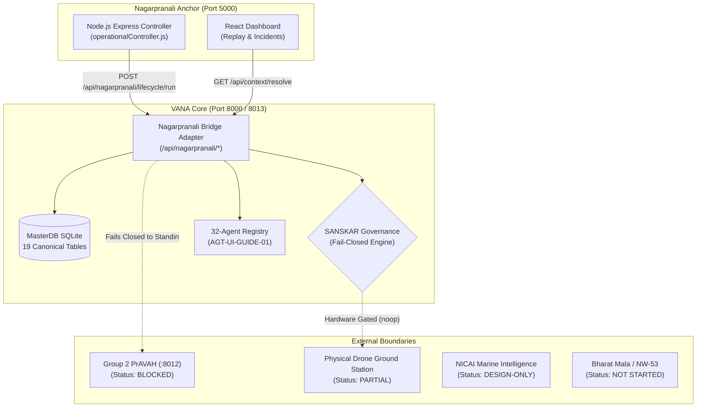

# NAGARPRANALI+ Phase 3: Integration Map & Component Disclosure
**Sprint:** 4-Hour Convergence & Proof Sprint  
**Owner:** Kaushalendra Yadav (Product, UX & Forest Department Workflow Owner)  
**Date:** 2026-11-21  
**Project Root:** `VANA/finalvana/`  
**Git Remote:** `https://github.com/PriteshPatra-BHIV/finalvana.git` (`origin/main`)  

---

## 1. Integration Status Map (Connected vs Disconnected)

In strict accordance with **Section 7 of the NAGARPRANALI+ Assignment**, this document maps every interface boundary across the convergence ecosystem:

---

## 2. Component Status Disclosure Matrix (Page 1 Sprint Rules)

| Component Name | Owner | Status | Technical Details & Boundary Proof |
| :--- | :--- | :---: | :--- |
| **MasterDB Canonical Store** | Pritesh Patra (VANA) | **WORKING** | 19 persistent SQLite tables (`vana_api.db`) verified with SHA-256 idempotency. |
| **SANSKAR Governance Engine** | Pritesh Patra (VANA) | **WORKING** | Fail-closed security doctrine strictly enforced: uncalibrated context produces `ABSTAIN (noop)`. |
| **Nagarpranali Environmental Adapter** | Kaushalendra Yadav (VANA) | **WORKING** | Authoritative envelopes for Thane Creek (`TC-Z03`), Maval (`MV-Z01`), and Samachar (`SMR-Z01`). |
| **32-Agent Governed AI Ecosystem** | Raj / Ashwini / Kaushalendra | **WORKING** | Declarative registry (12 Operational, 6 Integrating, 14 Planned) with pause/resume and rate limits. |
| **Live Port 8012 PrAVAH Socket** | Group 2 PrAVAH | **BLOCKED** | Port 8012 unreachable in sandbox; transparent deterministic synthetic fallback active. |
| **Physical Drone Actuator Dispatch** | TANTRA / SANSKAR | **PARTIAL** | Two-Man Rule statutory flight plan simulation verified; physical actuators safely gated to noop. |
| **NICAI Marine Intelligence** | Shravani / Ankita (NICAI) | **DESIGN-ONLY** | Awaiting repository handoff; mocked in demo review packet. |
| **Bharat Mala / NW-53 Gateway** | Bharat Mala Team | **NOT STARTED** | Verification-gated data policy: unverified corridor terminals remain excluded. |

---

## 3. Negative Invariants & Security Hardening (Verified)

1. **Empty / Whitespace Location:** Gracefully caught without 500 crash; returns `status: abstain`, `statutory_action: noop`, and authentic receipt (`ABS-...`).
2. **Extreme / Out-of-Envelope Coordinates:** Coordinates such as `(999.0, 999.0)` or `(0.0, 0.0)` strictly evaluate to `ABSTAIN` (noop)—zero fictional green-cover scores.
3. **Trace Propagation:** Every invocation generates a unique immutable trace ID starting with `VANA-NP-` linking the Nagarpranali civic alert to VANA's MasterDB canonical record (`CR-...`).
4. **Zero Frontend-Only Security:** All governance decisions, RBAC checks, and abstention rules are enforced by the backend runtime.

---

## 4. Phase 3 Exit Evidence Checklist
- [x] Component status disclosure endpoint exposed at `/api/nagarpranali/components/status`.
- [x] End-to-end replay schema aligned with Nagarpranali React `ReplaySessions.jsx`.
- [x] All 6 integration & negative hardening tests in `tests/test_phase3_nagarpranali_integration.py` passing (0.59s).
- [x] All work strictly contained in `finalvana/` (`bhiv-Nagar-Pranali` untouched).
