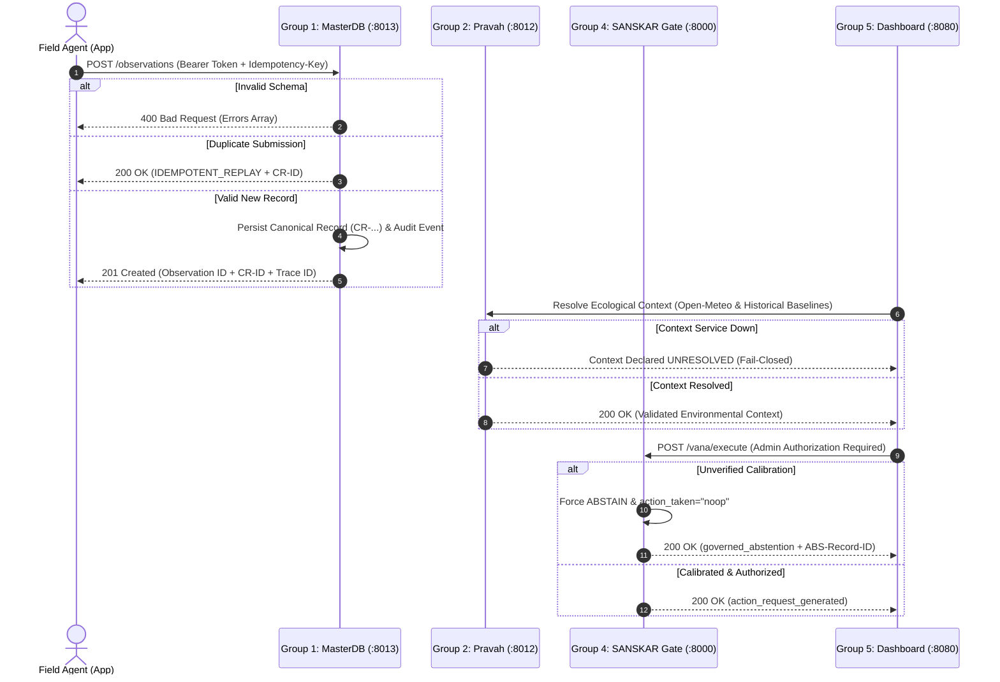

# VANA Phase 1 — BIQOS Capability Alignment & Architecture Mapping

**Document Version:** 1.0.0 (Phase 1 Production Release)  
**Framework:** BIQOS 5-Pillar Operating Architecture  
**Sprint Mandate:** VANA × BIQOS 4-Hour Sprint Task Assignment (18 Nov 2026)  
**Product Owner:** Kaushal Yadav, Product, UX & Forest Department Workflow Owner  
**Last Verified:** 2026-11-20

---

## 1. Executive Summary

The VANA platform aligns directly with the **BIQOS Enterprise Operating Model** across five core pillars:
1. **Identity & Access Management:** Cryptographic session tokens, backend-enforced RBAC, and fail-closed security.
2. **Data & MasterDB Ledger:** Group 3 v2.2 schema contracts, canonical records (`CR-...`), and SHA-256 idempotency.
3. **Workflow & Orchestration:** 6-stage deterministic pipeline (Capture → Validate → Ledger → Context → Governance → Lineage).
4. **Governance & Fail-Closed Policy Gates:** SANSKAR statutory policy gate, uncalibrated hardware fail-closed `ABSTAIN` invariant, zero simulated execution.
5. **Observability, Lineage & Audit:** Immutable audit ledger, deterministic replay engine, and genuine database telemetry.

---

## 2. Five-Pillar Capability Matrix

| BIQOS Pillar | VANA Subsystem | Technical Implementation | Current Verified Status |
|---|---|---|---|
| **Pillar 1: Identity & Access** | `unified_auth_runtime.py`, `auth_service.py`, `admin-auth.js` | Bearer token verification, PBKDF2 hashing, 24h session expiration, RBAC roles (`ADMIN`, `FOREST_OFFICER`, `FIELD_AGENT`). | **VERIFIED** (Automated test pass: 32 frontend, 11 backend) |
| **Pillar 2: Data & MasterDB** | `group1-masterdb` (`api/main.py`, `api/persistence.py`) | Group 3 v2.2 schema enforcement, SQLite / PostgreSQL persistence, `Idempotency-Key` deduplication, FSI statutory benchmarks. | **VERIFIED** (Zero fabrication, SHA-256 idempotency verified) |
| **Pillar 3: Workflow & Orchestration** | `group3-sensor-contracts`, `app.js`, `api/main.py` | Dual-mode field intake (form & JSON), device GPS acquisition, offline `localStorage` queueing, automated batch sync. | **VERIFIED** (End-to-end trace from capture to canonical persistence) |
| **Pillar 4: Governance & Gates** | `group4-workflow-runtime`, SANSKAR Policy Gate (:8000) | Fail-closed decision gate: unverified calibration forces `effective_ruling: ABSTAIN` and `action_taken: noop`. | **VERIFIED** (Constitutional fail-closed rule mathematically enforced) |
| **Pillar 5: Observability & Lineage** | `group5-lineage-dashboard` (`app.js`, `index.html`) | Canonical audit trail (`recent_events`), deterministic state replay engine, genuine statutory FSI ISFR reports. | **VERIFIED** (Honest empty states and zero fabricated events) |

---

## 3. Integration Boundaries & Guarantees

---

## 4. AI Assistance Architecture Notice

In accordance with constitutional zero-fabrication principles:
- The **VANA Guidance Assistant** (`#assistantDrawer`) is documented and operated strictly as **one deterministic, client-side contextual rule explainer**.
- It does **not** hallucinate autonomous decision-making or simulate a backend network of 30 generative agents.
- It translates complex statutory policy clauses, SANSKAR calibration rules, and field agent GNSS requirements into plain language for operational personnel.
