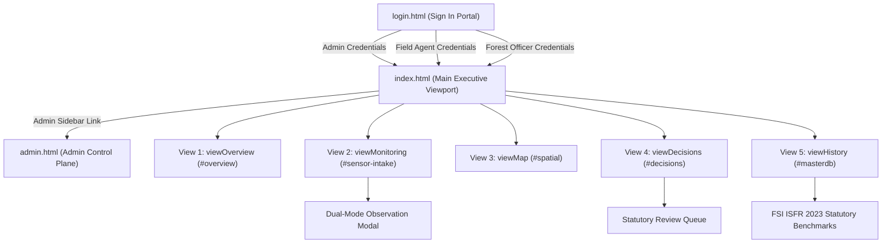

# VANA Phase 1 — Comprehensive Screen Map & UI Navigation Architecture

**Document Version:** 1.0.0 (Phase 1 Production Release)  
**Interface:** VANA Environmental Intelligence Command Center (`finalvana/frontend/group5-lineage-dashboard/vana-control-center/`)  
**Sprint Mandate:** VANA × BIQOS 4-Hour Sprint Task Assignment (18 Nov 2026)  
**Product Owner:** Kaushal Yadav, Product, UX & Forest Department Workflow Owner  
**Last Verified:** 2026-11-20

---

## 1. High-Level Application Layout

The VANA Command Center employs a responsive, dark-mode glassmorphic architecture consisting of:
1. **Top Header Bar:** Official Government of Maharashtra branding, live IST/UTC digital clock, backend availability pulse pill, alert counters, theme toggle, and authenticated user profile pill.
2. **Left Navigation Sidebar (Desktop):** Collapsible command menu with role-tailored links (Overview, Spatial, Monitoring, Reviews & Decisions, History & Lineage, Administration).
3. **Bottom Navigation Bar (Mobile / Touch Viewports):** 5-item bottom bar for mobile field operations.
4. **Executive Viewport Container:** Houses the active view section dynamically switched via `switchMainTab()`.
5. **Contextual Overlays:** Modal dialogs, offline queue notifications, and the dismissible VANA Guidance Assistant.

---

## 2. Master Screen & View Directory

---

## 3. View Specifications

### View 1: Operational Overview (`#viewOverview`)
- **Route / Hash:** `index.html#overview` (Default Landing Page)
- **Role Welcome Banner (`#roleWelcomeBanner`):**
  - Displays dynamic role-specific cards (`field-agent`, `forest-officer`, `admin`).
  - Provides instant access to primary actions (+ Start Observation, Review Queue, or Admin Plane).
- **Top KPI Metrics Row:**
  - Sensor Events Ingested.
  - MasterDB Records Validated.
  - Fail-Closed Governance Stance (`ABSTAIN` / `noop` active).
  - Data Integrity (100% Sealed with SHA-256).
  - Regional Coverage (6 Monitored Maharashtra Zones).
- **Surveillance Zone Overview Cards:**
  - Thane Creek Mangrove Reserve (`TC-Z03`).
  - Sanjay Gandhi National Park (`SGNP-Z01`).
  - Tadoba-Andhari Tiger Reserve (`TAD-Z04`).
  - Navegaon-Nagzira Corridor (`NAV-Z02`).
  - Chandoli National Park (`CHAN-Z05`).
  - Koyna Wildlife Sanctuary (`KOY-Z06`).
- **Live System Activity Feed:** MasterDB ingestion events, governance evaluations, and statutory report queries.

---

### View 2: Environmental Monitoring & Sensor Intake (`#viewMonitoring`)
- **Route / Hash:** `index.html#sensor-intake`
- **Header Actions:**
  - **`#btnOpenSubmitObsModal`:** Launches the Dual-Mode Observation Modal.
  - **`#monOfflineStatusBar`:** Visible when offline observations are queued locally, with a **Sync Now** button.
  - **`#ingestionInfoPill`:** Group 3 v2.2 schema intake architecture notice.
- **Monitoring Statistics Summary Grid:**
  - Total Monitored Locations (6).
  - Locations with Available Data (Retrieved MasterDB Records).
  - Locations Awaiting Sensor Data (Pending upstream deployment).
- **Retrieved Observations Directory:** Canonical records retrieved from MasterDB via `/observations` with parameter search, location filters, and JSON inspection modals.

---

### View 3: Spatial Intelligence & Regional Monitoring (`#viewMap`)
- **Route / Hash:** `index.html#spatial`
- **Leaflet Geospatial Map Container:**
  - Official boundary polygon mapping for Maharashtra surveillance zones.
  - GeoJSON layer toggles: Sensor Telemetry Stations, Mangrove Conservation Zones, Tiger Corridors.
  - Interactive Zone Markers: Click opens detailed modal with coordinates, active sensor count, and historical telemetry status.
- **Floating Controls:** Zoom In/Out, Recenter Maharashtra, Boundary Layer Selector.

---

### View 4: Statutory Reviews & Governance Decisions (`#viewDecisions`)
- **Route / Hash:** `index.html#decisions`
- **Forest Officer Statutory Review Queue (`#foReviewQueuePanel`):**
  - Displays ingested observations requiring statutory verification.
  - Shows Observation ID, Surveillance Zone, Parameter, Timestamp, Sensor Calibration, and Governance Ruling.
  - Action button: **"Inspect & Audit"** to load observation into detailed review.
- **Decision Summary Grid:**
  - Active Observation Evaluated.
  - SANSKAR Governance Ruling (`ABSTAIN` / `ALLOW`).
  - Operational Execution State (`NO DISPATCH` / `Zero Side-Effects`).
  - Declared Data Gaps (Contract §26 / §49.1 calibration gaps).
- **Detailed Evaluation Accordion:**
  - Pravah Ecological Context Resolution.
  - Statutory Policy Clause Citations.
  - Fail-Closed Rationale Explanation.
  - Explicit notification: "Execution dispatch is restricted to Admin personnel."

---

### View 5: Audit, Lineage & Statutory Benchmarks (`#viewHistory`)
- **Route / Hash:** `index.html#masterdb`
- **Subtab Switcher:**
  - Subtab 1: Pipeline Trace & Lineage Stepper (5-stage end-to-end pipeline).
  - Subtab 2: Replay & Diff Engine (deterministic state reconciliation).
  - Subtab 3: Emitted Evidence Pack (v2.2 JSON viewer with syntax highlighting).
  - **Subtab 4: Statutory Forest Cover Benchmarks (FSI ISFR 2023):**
    - State-level canonical forest cover area (`50,798 km²`, 16.51% of geographic area).
    - Canopy density classification: Very Dense Forest (`8,720 km²`), Moderately Dense Forest (`20,589 km²`), Open Forest (`21,489 km²`).
    - Query MasterDB button (`loadOfficialForestCover()`) reconciling statutory benchmarks.

---

## 4. Modal Overlays & Guidance Components

1. **Dual-Mode Observation Modal (`#observationSubmitModal`):**
   - **Mode 1: Field Capture Form:** Structured inputs for zone, parameter, value, device GNSS capture, UTC time autofill, and photo attachment preview.
   - **Mode 2: Advanced JSON Payload:** Monaco/textarea JSON editor with sample contract payload loaders (`canopy`, `precipitation`, `invalid`).
   - Universal Idempotency Key generator (`IK-VANA-...`).
   - Network status pill (Online vs Offline local storage indicator).
2. **Observation Details Modal (`#observationDetailsModal`):** Displays formatted JSON, GNSS coordinates, calibration certificates, and provenance references.
3. **Zone Info Modal (`#zoneInfoModal`):** Shows surveillance zone geographic metadata, monitoring authority, and focus map trigger.
4. **VANA Guidance Assistant (`#assistantDrawer`):** Slide-out panel providing plain-language explanations of governance rulings, fail-closed security doctrine, and field agent recovery guidance.
