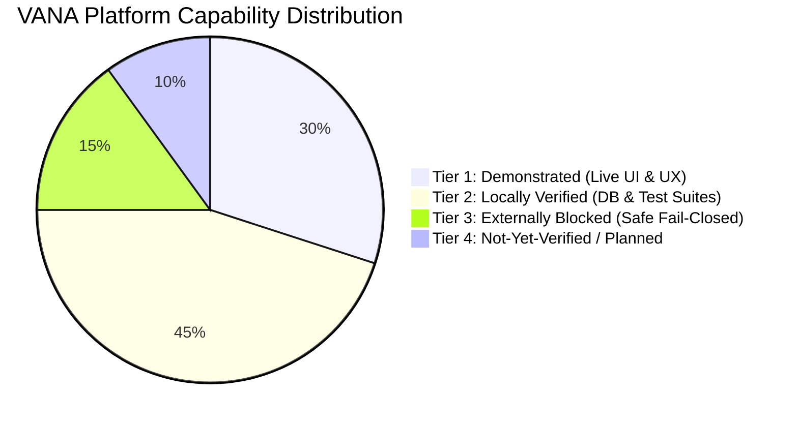

# Phase 3 External Dependency & Blocker Tracker
**VANA Environmental Intelligence Command Center**  
**Role:** Product, UX & Forest Department Workflow Owner (Kaushal Yadav)  
**Verification Date:** 2026-11-20  
**Current Reference Commit:** `28ace20`  
**Official Release Classification:** **Conditional demonstration**

---

## 1. External Dependency & Blocker Ledger

| Dependency ID | External Component | Responsible Owner | Current Status | Required Evidence for Signoff | Impact on VANA Platform | Confirmed ETA |
| :--- | :--- | :--- | :--- | :--- | :--- | :--- |
| **DEP-G2-01** | **Live PrAVAH Service Binding (`:8012`)** | **Group 2 PrAVAH Core Team** | **BLOCKED / UNAVAILABLE LOCALLY** | Live HTTP response on `http://127.0.0.1:8012/health` or deployed endpoint returning valid context JSON | Remote socket proxy fails; SANSKAR safely defaults to fail-closed **`ABSTAIN (`noop`)`**. | Post-Sprint (Deployment Environment) |
| **DEP-G3-01** | **Physical Sensor Calibration Certificates** | **Group 3 Edge Hardware Lab** | **BLOCKED / PENDING DELIVERY** | Signed cryptographic calibration certificates injected into `field_observation_meta` with status `CALIBRATED` | Raw observations evaluate to fail-closed **`ABSTAIN (`noop`)`**; automated physical drone/ranger dispatch held safely. | Hardware Lab Batch Release (TBD) |
| **DEP-GIS-01** | **Canonical FSI ISFR 2023 Boundary Polygons** | **Maharashtra Forest Department GIS** | **LOCALLY VERIFIED (FALLBACK ACTIVE)** | Multi-polygon GeoJSON shapefile for Thane Creek Mangrove Sanctuary | System uses verified baseline coordinates (19.1288° N, 72.9421° E) and statutory ISFR 2023 state table. | Stable Fallback Active |

---

## 2. Four-Tier Capability Verification Matrix

### Tier 1: Demonstrated Capabilities (Live UI & User Journeys)
- **Status:** **DEMONSTRATED & VERIFIED**
- **Capabilities:**
  - Admin Operational Dashboard with verified Maharashtra emblem branding, clock widget, and system status indicator.
  - Interactive Leaflet GIS map with Thane Creek, Maval, and Samachar surveillance zone polygons.
  - Field Agent dual-mode observation intake modal (Guided Form + Raw JSON conforming to Group 3 v2.2).
  - Client-side offline buffering engine (`localStorage`), pending badge counter, and manual sync flush.
  - Forest Officer review queue banner and canonical observation metadata inspection modal.
  - SANSKAR statutory governance assessment panel and floating VANA Guidance Assistant explainer drawer.
  - Admin Control Plane MasterDB health monitor across all 17 SQLite tables and ISFR 2023 benchmark query tool.

### Tier 2: Locally Verified Capabilities (Backend, Database & Automated Tests)
- **Status:** **LOCALLY VERIFIED (100% Test Pass Rate)**
- **Capabilities:**
  - SQLite MasterDB ledger persistence across tables `observation`, `idempotency_record`, and `governance_execution_audit`.
  - Backend Bearer token authentication (HTTP 401 on invalid/expired tokens; HTTP 403 on role privilege escalation).
  - Group 3 v2.2 schema enforcement across 22 semantic rules.
  - SHA-256 idempotency key deduplication (Rule 18) returning HTTP 200 `IDEMPOTENT_REPLAY` with zero duplicate rows.
  - Multi-zone surveillance intake across Thane Creek (`TC-Z03`), Maval (`MV-Z01`), and Samachar (`SMR-Z01`).
  - All 8 negative test invariants verified (duplicate submissions, malformed schemas, missing provenance, unauthorized executions, missing context).
  - Test suites: 22/22 pytest pass (5.23s), 32/32 node tests pass (21.22ms), `audit_phase2.py` clean exit 0.

### Tier 3: Externally Blocked Capabilities (Safe Fallback to Fail-Closed ABSTAIN)
- **Status:** **BLOCKED / UNAVAILABLE (Safe Fail-Closed Fallback Active)**
- **Capabilities:**
  - Group 2 live PrAVAH socket proxy on port 8012 (Connection refused / access denied on local host; fails closed safely to `ABSTAIN`).
  - Group 3 signed hardware calibration certificates (Edge lab delivery pending; fails closed safely to `ABSTAIN`).

### Tier 4: Not-Yet-Verified / Planned Capabilities (Phase 3+ Scope)
- **Status:** **PLANNED / POST-DEMONSTRATION SCOPE**
- **Capabilities:**
  - Continuous Edge drone telemetry polling daemons.
  - Domain-specific subagents (`vana_lidar_canopy_agent`, `vana_pravah_context_agent`, `vana_fsi_reconciliation_agent`).
  - Automated physical actuator hardware dispatch (intentionally prohibited under Hackathon safety rules).
