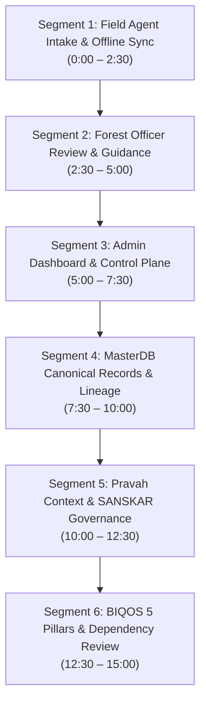

# Phase 3 Stakeholder Demonstration Walkthrough
**VANA Environmental Intelligence Command Center**  
**Role:** Product, UX & Forest Department Workflow Owner (Kaushal Yadav)  
**Target Audience:** Maharashtra Forest Department, BIQOS Platform Leadership, Hackathon Evaluators  
**Presentation Duration:** 10–15 Minutes  
**Current Baseline Commit:** `28ace20`  
**Official Release Classification:** **Conditional demonstration**

---

## 1. Executive Framing & Demonstration Doctrines

1. **Zero-Fabrication Doctrine:**
   - No simulated telemetry or synthetic approvals. Every record shown exists in the MasterDB SQLite database.
2. **Historical / Benchmark Data Grounding:**
   - Monitored surveillance observations (`TC-Z03`, `MV-Z01`, `SMR-Z01`) are **historical / test mission benchmark packages dated 2026-08-28T14:45:00Z**. They are explicitly used for deterministic validation and are **not** represented as live streaming telemetry.
3. **Fail-Closed Security Invariant:**
   - Uncalibrated sensors or unreachable context strictly evaluate to **`ABSTAIN`** with action **`noop`**. Automated physical dispatches are safely held.
4. **Credential & Secret Sanitization:**
   - All evaluation accounts use sanitized placeholders (`[DEMO_ADMIN_ACCOUNT]`, `[DEMO_FIELD_AGENT_ACCOUNT]`, `[DEMO_FOREST_OFFICER_ACCOUNT]`). Zero production secrets or raw Bearer tokens are exposed.

---

## 2. 12–15 Minute Timed Demonstration Agenda

---

### Segment 1: Field Agent Observation Submission & Offline Resilience (0:00 – 2:30)
**Presenter Persona:** Field Operations Agent (`[DEMO_FIELD_AGENT_ACCOUNT]`)

1. **Sign In as Field Agent:**
   - Click **Sign In** in the top-right header and log in as Field Agent.
   - Observe header role badge dynamically updates to **`Field Operations Agent (ROLE_FIELD_AGENT)`**.
   - Note the **Field Operations Workspace Banner** at the top of the viewport:
     > *"Field Operations Mode: You can capture raw environmental observations and sync offline caches."*
   - Note that the **Administration** navigation link is hidden from non-admin roles (Role-Based UI boundary).
2. **Open Dual-Mode Intake Modal:**
   - Click the green **+ Submit Observation** button in the header.
   - Showcase **Dual-Mode Intake**:
     - *Guided Form Mode:* Structured inputs for Survey ID, Zone ID, Flight ID, Sensor ID, Metric Value, and Coordinates.
     - *Raw JSON Mode:* Strict Group 3 Contract v2.2 JSON editor with live pre-check.
3. **Demonstrate Field Telemetry Intake:**
   - Select or configure surveillance zone:
     - **Thane Creek Mangroves (`TC-Z03`):** LiDAR Canopy Density `74.5%` (19.1288° N, 72.9421° E).
     - **Maval Western Ghats (`MV-Z01`):** Canopy Height `16.2 m` (18.7180° N, 73.4730° E).
     - **Samachar Estuary (`SMR-Z01`):** Optical Index `8.4` (19.2220° N, 72.9560° E).
   - Click **Validate & Ingest into MasterDB**.
   - Show success notification: Observation accepted with canonical record ID (`CR-...`).
4. **Demonstrate Offline Queue Engine:**
   - Click **Save to Offline Queue** to simulate capturing telemetry during a network dead-zone.
   - Show badge counter: *"Offline Queue: 1 pending"*.
   - Telemetry is buffered in browser `localStorage` (`vana_offline_observations`).
   - Click **Sync Queue**: Show cached observations successfully ingested into MasterDB.

---

### Segment 2: Forest Officer Observation Review & Guidance (2:30 – 5:00)
**Presenter Persona:** Forest Review Officer (`[DEMO_FOREST_OFFICER_ACCOUNT]`)

1. **Sign In as Forest Officer:**
   - Switch role to Forest Officer.
   - Role badge updates to **`Forest Review Officer (ROLE_FOREST_OFFICER)`**.
   - Note the dedicated **Forest Officer Review Queue Banner**:
     > *"Forest Officer Review Mode: Review pending environmental observations and inspect SANSKAR statutory rulings."*
2. **Inspect Monitored Observation:**
   - Select historical test observation `TC-Z03-F02-LIDAR-OBS889` *(Historical Benchmark Telemetry: 2026-08-28)*.
   - View telemetry parameters, sensor metadata, and location coordinates.
3. **Inspect SANSKAR Governance Assessment:**
   - Point to the Governance Decision panel:
     - **Ruling:** **`ABSTAIN`**
     - **Action Taken:** **`noop`** (No operation; physical dispatch blocked)
     - **Abstention Record ID:** `ABS-9B9F1C4418F1`
     - **SANSKAR Event ID:** `evt_1795166521954_389`
     - **Statutory Decision Rationale:** *"Authoritative evidence threshold not met (Context not verified). Failing closed to ABSTAIN."*
4. **VANA Guidance Assistant Drawer:**
   - Click the floating **VANA Assistant** pill in the lower-right corner.
   - Review the explanation drawer: Demonstrates deterministic rule explanation, explains why the dispatch is held under the Fail-Closed doctrine, and provides recovery steps.

---

### Segment 3: Admin Operational Dashboard & Authorized Controls (5:00 – 7:30)
**Presenter Persona:** Platform Administrator (`[DEMO_ADMIN_ACCOUNT]`)

1. **Sign In as Platform Administrator:**
   - Log in as Administrator.
   - Role badge updates to **`Platform Administrator (ROLE_ADMIN)`**.
2. **Walkthrough Executive Dashboard:**
   - Verified Government of Maharashtra emblem branding and typography.
   - Real-time UTC clock widget and live MasterDB connectivity pill (**System Operational**).
   - Monitored surveillance KPI metrics: Total Observations, Monitored Zones, Governed Events.
   - Interactive Leaflet GIS map with Maharashtra surveillance zone boundaries and recenter control.
3. **Admin Control Plane Access:**
   - Open **Administration** from the sidebar navigation.
   - Inspect MasterDB table health across all 17 SQLite tables.
   - Inspect Statutory Benchmarks (FSI ISFR 2023) sub-tab.
   - Point out that **`POST /vana/execute`** is strictly restricted to this Administrator role via backend JWT verification.

---

### Segment 4: MasterDB Canonical Records & Evidence Lineage (7:30 – 10:00)
**Presenter Goal:** Prove database durability and cryptographic idempotency protection.

1. **Open Lineage Subtab (`#subtabLineage`):**
   - Navigate to **Lineage & History** in the sidebar.
   - Show the Directed Acyclic Graph (DAG) tracing:
     `Field Ingestion` → `Semantic Validation` → `MasterDB Canonical Record` → `Pravah Context` → `SANSKAR Evaluation` → `Lineage Log`.
2. **Authoritative MasterDB SQLite Proof:**
   - Show canonical record ID: `CR-7da754a8-a300-445e-9c41-493524ad775f`.
   - Show SHA-256 idempotency key: `IK-TC-Z03-F02-LIDAR-OBS889`.
   - Show MasterDB trace ID: `VANA-c2d1d3e70d17`.
3. **Demonstrate Idempotent Duplicate Replay:**
   - Explain how re-submitting an identical observation returns HTTP 200 `IDEMPOTENT_REPLAY` and inserts **0 duplicate rows** into MasterDB table `observation`.

---

### Segment 5: Pravah Context Resolution & SANSKAR Governance (10:00 – 12:30)
**Presenter Goal:** Demonstrate governance safety, ALLOW vs ABSTAIN conditions, and fail-closed integrity.

1. **Explain the Pravah Scientific Role:**
   - Group 2 PrAVAH maps raw observation telemetry to hydrologic catchment models and estuarine baselines.
2. **Pravah External Boundary Stance:**
   - Local deterministic resolver is verified and active.
   - Remote socket proxying on port 8012 is blocked in local sandbox.
   - When port 8012 is unreachable, VANA does **not** fail or fabricate approvals; it strictly falls closed to **`ABSTAIN` (`noop`)**.
3. **SANSKAR Governance Comparison:**
   - **`ALLOW` Condition:** Requires valid Bearer JWT + Verified canonical record + Signed hardware calibration certificate + Authoritative context ID.
   - **`ABSTAIN` (Enforced Invariant):** If ANY component is missing (uncalibrated sensor, missing context, non-admin role), SANSKAR overrides to **`ABSTAIN`** with action **`noop`** and generates an immutable receipt (`ABS-...`).

---

### Segment 6: BIQOS Five-Pillar Conformance & Dependency Review (12:30 – 15:00)
**Presenter Goal:** Present authoritative BIQOS alignment evidence, review the dependency register, and take stakeholder questions.

1. **BIQOS Five Pillars Conformance:**
   - **Identity & Access:** Cryptographically verified Bearer JWTs; backend RBAC (Admin, Forest Officer, Field Agent).
   - **Data & Metadata:** Group 3 Contract v2.2 schema persisted in SQLite MasterDB.
   - **Workflow & Correlation:** Distributed trace propagation via `X-Trace-ID` and `X-Correlation-ID`.
   - **Governance & Execution:** SANSKAR statutory compliance engine; fail-closed enforcement.
   - **Observability:** Lineage DAG, audit stream queryable via `GET /api/v1/summary`.
2. **AI Agent Inventory:**
   - Ground truth: Exactly 1 operational client-side helper (`VANA Guidance Assistant`), 1 specified product agent (`vana_forest_governance_agent`), 0 autonomous actuators. Zero fabrication.
3. **Outstanding Dependencies & Q&A:**
   - Review the external blocker register and conclude with the official release classification: **Conditional demonstration**.
