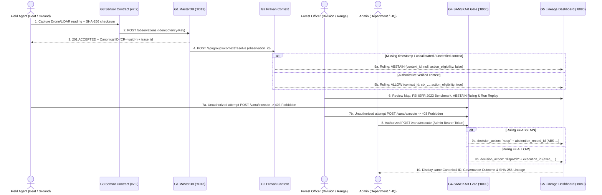

# VANA | End-to-End Forest Department Role User Journeys

**Document Reference:** `BHIV-VANA-PROD-JOURNEYS-2026-11`  
**Owner:** Kaushal Yadav (Product & Forest Department Workflow Owner, BHIV)  
**Target Repository:** `finalvana-main`  
**Status:** Approved Product Journey Specification (EOD Release Scope)  
**Companion Specification:** [VANA_FOREST_SCOPE_HIERARCHY_AND_RBAC_MATRIX.md](VANA_FOREST_SCOPE_HIERARCHY_AND_RBAC_MATRIX.md)

---

## 1. Shared End-to-End Runtime Path (All 3 Roles Connected)

VANA is not three isolated views — every role participates in one continuous, traceable **Observation → Context → Governed Outcome → Lineage** workflow:

---

## 2. Journey 1 — Field Agent (Beat / Ground Staff)

**Persona:** Forest Ranger / Beat Officer / Edge Drone Operator  
**Canonical Role:** `FIELD_AGENT`  
**Auth Config Reference:** Configured via `VANA_FIELD_EMAIL` / `VANA_FIELD_PASSWORD` (no plaintext secrets committed; see `DEC-VANA-01` for local demo default).  
**Primary Objective:** Capture, validate, and submit verified environmental observations from Thane Creek Mangrove Sanctuary (Zone Z03) with full provenance and zero data fabrication.

### 2.1 Happy Path — Valid Field Observation Intake
1. **Authentication:**
   - Field Agent navigates to `login.html`, selects role `Field Agent`, enters authorized credentials.
   - Frontend calls `POST /proxy/auth/login` → Backend validates `bcrypt` hash & role match → Returns session Bearer token with `role: "FIELD_AGENT"` and permissions `["VIEW_DASHBOARD", "VIEW_MAP", "VIEW_ALERTS", "VIEW_LINEAGE", "SUBMIT_OBSERVATION", "INTAKE_SENSOR_DATA", "REGISTER_SENSOR", "VIEW_TELEMETRY"]`.
   - Frontend stores token in tab-scoped `sessionStorage` and validates via `GET /proxy/auth/me`.
2. **Role-Scoped Landing Experience:**
   - Lands on `index.html` (`overviewView` / `monitoringView` / `fieldOps`).
   - Role badge displays **`Field Agent`**.
   - **Admin Control Plane (`navItemAdmin`)** and **Statutory Reports (`navItemAnalytics`)** are hidden.
3. **Observation Submission (Group 3 → Group 1):**
   - Opens observation intake (`#btnOpenSubmitObsModal` — tracked under `DEF-02` for UI restoration; currently verified via API).
   - Submits Group 3 `v2.2` payload (e.g., `TC-Z03-F02-LIDAR-OBS100501`, coordinates `19.1288, 72.9421`, canopy height `4.7 m`, valid ISO-8601 `observation_timestamp`, `provenance_reference`, and 64-char `checksum_sha256`) with `Idempotency-Key` header to `POST /proxy/g1/observations`.
   - **Expected System Response:** `HTTP 201 Created`, `status: "ACCEPTED"`, deterministic `canonical_record_id: "CR-<uuid>"`, and `trace_id: "VANA-<hex>"`.
4. **Telemetry & Intake Confirmation:**
   - Field Agent checks `monitoringView` / `mapView` → Newly persisted Thane Creek observation appears with its exact `CR-<uuid>` canonical ID and provenance status.

### 2.2 Exception & Negative Paths (Mandatory Verification)
| Scenario | Field Agent Action | Required System Behavior | Required UI State |
| :--- | :--- | :--- | :--- |
| **Duplicate Replay** | Resubmits identical payload + same `Idempotency-Key` | `HTTP 200 OK`, `status: "IDEMPOTENT_REPLAY"`, returns **identical** `CR-<uuid>`, zero duplicate DB rows | Shows `Idempotent Replay` notice; count does not double-increment |
| **Idempotency Conflict** | Reuses same `Idempotency-Key` with modified measurement (e.g. `4.7 m` → `9.2 m`) | `HTTP 409 Conflict`, `status: "IDEMPOTENCY_CONFLICT"`, original DB value (`4.7 m`) preserved untouched | Displays explicit conflict error; rejects mutation |
| **Malformed / Missing Timestamp** | Submits payload missing `observation_timestamp` or invalid schema field | `HTTP 400 Bad Request`, `status: "REJECTED"` with structured validation error list; **zero fallback timestamp synthesized** | Displays field-level rejection errors; record not persisted |
| **Unauthorized Execution Attempt** | Attempts `POST /proxy/g4/vana/execute` using Field Agent Bearer token | `HTTP 403 Forbidden` (`Execution dispatch requires ADMIN privileges`) | Execute controls hidden in UI; API fail-closed at `403` |
| **Unauthorized Admin Page Access** | Navigates directly to `/admin.html` | Redirected / blocked by `admin-auth.js` (`ADMIN` role required) | Explicit access-denied state; zero admin data rendered |

---

## 3. Journey 2 — Forest Officer (Division / Range)

**Persona:** Divisional Forest Officer (DFO) / Range Forest Officer (RFO)  
**Canonical Role:** `FOREST_OFFICER`  
**Auth Config Reference:** Configured via `VANA_FOREST_EMAIL` / `VANA_FOREST_PASSWORD`.  
**Primary Objective:** Oversee regional surveillance zones, reconcile field telemetry against statutory FSI ISFR 2023 forest cover benchmarks, audit Group 2 `ABSTAIN`/`ALLOW` governance rulings, and verify deterministic lineage integrity.

### 3.1 Happy Path — Statutory Oversight, Governance Audit & Replay
1. **Authentication:**
   - Signs in via `login.html` with role `Forest Officer`.
   - Receives Bearer token with `role: "FOREST_OFFICER"` and permissions `["VIEW_DASHBOARD", "VIEW_MAP", "VIEW_ALERTS", "VIEW_LINEAGE", "VIEW_EVIDENCE", "RUN_REPLAY", "VIEW_FOREST_COVER", "VIEW_STATUTORY_BENCHMARKS", "VIEW_GOVERNANCE_DECISIONS", "VIEW_AUDIT_LOG"]`.
2. **Regional Spatial Surveillance (`mapView`):**
   - Views Thane Creek Mangrove Sanctuary (Zone Z03) live observation marker with exact coordinates (`19.1288, 72.9421`) and canonical ID.
   - Views the 5 additional regional zones (Konkan, Western Ghats, Marathwada, Vidarbha, Desh) clearly badged as **`STANDBY / PENDING DEPLOYMENT`** (never misrepresented as live active stations).
3. **Statutory Forest Cover Benchmark Verification (`analyticsView` / `#subtabForestCover`):**
   - Queries `GET /proxy/g1/datasets/DS-FSI-ISFR-2023-FOREST-COVER/forest-cover` (UI trigger tracked under `DEF-02`).
   - Reconciles live MasterDB statutory figures for Maharashtra (FSI ISFR 2023):
     - Total Forest Cover: **`50,858.53 km²` (`16.53%`)**
     - Very Dense: **`9,538.99 km²`** | Moderately Dense: **`15,827.39 km²`** | Open Forest: **`10,744.55 km²`**
     - Mangrove Cover: **`315.09 km²`**
   - Verifies source citation (`FSI ISFR 2023, Vol I, Table 2.4`) and cryptographic `request_fingerprint` (SHA-256).
4. **Governance Decision Audit (`decisionsView`):**
   - Selects an observation with uncalibrated hardware (`calibration_status: "NOT_VERIFIED"`) or missing upstream scientific verification.
   - Confirms Group 2 evaluated to **`ruling: "ABSTAIN"`**, `action_eligibility: false`, `context_id: null` (zero fabricated context IDs), and explicit `missing_critical_data` explanation.
   - Confirms Group 4 SANSKAR enforced **`decision_action: "noop"`** with audit record `ABS-...` — proving no unauthorized field action or clearance certificate was issued.
5. **Deterministic Lineage & Replay Verification (`historyView`):**
   - Inspects the 4-tier lineage rail (`G3 Capture` → `G1 MasterDB CR-<uuid>` → `G2 Pravah Context` → `G4 SANSKAR Outcome`).
   - Runs Deterministic Replay → Confirms all 4 invariants hold (`Identity`, `Ruling`, `Action`, `SHA-256 Hash` byte-for-byte match).
   - **Important Constitutional Rule (PDF Page 3):** Replay proves *what happened*; it never retroactively grants authorization to an unapproved action.

### 3.2 Exception & Negative Paths (Mandatory Verification)
| Scenario | Forest Officer Action | Required System Behavior | Required UI State |
| :--- | :--- | :--- | :--- |
| **Non-Existent Observation Lookup** | Searches unknown `observation_id` via `#headerObservationSelect` | `HTTP 404 Not Found` (`status: "NOT_FOUND"`) | Clears stale view; displays explicit `Not Found` fail-closed state |
| **Upstream G2 Unreachable (`DEF-05`)** | Requests context resolution while `niyantran.blackholeinfiverse.com` is unreachable | Fail-closed `ABSTAIN` (`GAP_IN_CANONICAL_RECORD` / `502` handled safely) | Shows `ABSTAIN / Upstream Unavailable` — never shows green `ALLOW` |
| **Unauthorized Execution Dispatch** | Attempts `POST /proxy/g4/vana/execute` with Officer token | `HTTP 403 Forbidden` | Dispatch button hidden/disabled; API rejects with `403` |
| **Unauthorized Policy / Admin Mutation** | Navigates to `/admin.html` | Blocked / redirected by `admin-auth.js` | No admin controls or service mutations exposed |

---

## 4. Journey 3 — Administrator (Department / HQ)

**Persona:** Principal Chief Conservator of Forests (PCCF) / Platform Administrator  
**Canonical Role:** `ADMIN`  
**Auth Config Reference:** Configured via `VANA_ADMIN_EMAIL` / `VANA_ADMIN_PASSWORD`.  
**Primary Objective:** Monitor end-to-end platform health across G1–G5, oversee governance policies and RBAC integrity, ingest official statutory benchmarks, and authorize governed workflow execution **strictly when governance evidence permits (`ALLOW`)**.

### 4.1 Happy Path — Command Plane Oversight & Governed Execution
1. **Authentication:**
   - Signs in via `login.html` with role `Platform Admin`.
   - Receives Bearer token with `role: "ADMIN"` and full administrative permission set (`EXECUTE_WORKFLOW`, `DISPATCH_EXECUTION`, `RUN_HEALTH_CHECK`, `VIEW_SERVICES`, `VIEW_POLICIES`, `MANAGE_GOVERNANCE_POLICIES`, `MANAGE_USERS`, etc.).
2. **System Health & Readiness Verification (`admin.html`):**
   - Opens Administration Control Plane (`navItemAdmin` → `admin.html`).
   - Triggers live microservice health probes:
     - `/proxy/g1/health` → `200 OK` (`VANA MasterDB Observation API`)
     - `/proxy/g4/health` → `200 OK` (`VANA Unified Auth & Execution Runtime`)
     - `/proxy/g2` → Live latency or explicit `UNAVAILABLE / FAIL-CLOSED` badge (never faked green).
3. **Governed Execution Gate — Scenario A: Fail-Closed `ABSTAIN` (Mandatory Demo Path):**
   - Reviews a Thane Creek observation whose Group 2 ruling is **`ABSTAIN`** (uncalibrated sensor / unverified context).
   - Invokes `POST /proxy/g4/vana/execute` with Admin Bearer token.
   - **Required System Behavior:** Even with `ADMIN` credentials, SANSKAR enforces **`status: "governed_abstention"`**, **`decision_action: "noop"`**, **`governance_allowed: false`**, and issues **`abstention_record_id: "ABS-..."`** + `event_id`.
   - *Rule:* Admin identity cannot override a missing-evidence `ABSTAIN` ruling into an unsafe execution.
4. **Governed Execution Gate — Scenario B: Authorized Execution (`ALLOW` Path):**
   - Reviews an observation with verified calibration, valid timestamp, verified provenance hash, and authoritative Group 2 ruling **`ALLOW`** + valid `context_id`.
   - Invokes `POST /proxy/g4/vana/execute` with Admin Bearer token.
   - **Required System Behavior:** Returns `HTTP 200 OK`, **`status: "action_request_generated"`**, **`decision_action: "dispatch"`**, **`governance_allowed: true`**, and traceable **`execution_id: "exec_..."`** + `event_id` persisted for lineage audit (`BLK-VANA-02` tracks DB persistence hardening).
5. **User Directory & Governance Boundary Transparency:**
   - Checks User Directory section in `admin.html` → Displays explicit honest status: *"Awaiting backend directory service"* (`Unavailable`), adhering to zero-simulation standards.
   - Checks Governance Policies panel → Confirms fail-closed invariant and closed registration (`POST /auth/register` → `403`) are active.

### 4.2 Exception & Negative Paths (Mandatory Verification)
| Scenario | Admin / External Action | Required System Behavior | Required UI State |
| :--- | :--- | :--- | :--- |
| **Missing / Expired Token** | Calls `POST /proxy/g4/vana/execute` or `GET /proxy/auth/me` without valid Bearer token | `HTTP 401 Unauthorized` | Immediately clears session and redirects to `login.html` |
| **Public Registration Probe** | Attempts `POST /proxy/auth/register` | `HTTP 403 Forbidden` (Registration Disabled) | No registration form or endpoint exposed |
| **Persistence / Downstream Failure** | Database locked or downstream service unreachable | Returns structured `500` / `502` error with `trace_id`; zero silent drop or fake `200 OK` | Displays explicit error banner with `trace_id` for runbook triage |

---

## 5. Collective Shared Sample Observation Acceptance Scenario (All 4 Owners)

To satisfy the collective ownership gate in the assignment, all 4 team members must validate **one shared canonical sample dataset** end-to-end across the deployed candidate:

1. **Sample Observation Input (G3):** `TC-Z03-F02-LIDAR-OBS100501` — Thane Creek Mangrove Sanctuary (`19.1288, 72.9421`), canopy height `4.7 m`, `calibration_status: "NOT_VERIFIED"`, valid ISO-8601 timestamp, SHA-256 raw artifact checksum `f7254999689ae5b5...`.
2. **Ingestion & Persistence (G1 — Field Agent Journey):** `POST /observations` with `Idempotency-Key` → `201 ACCEPTED`, assigns `CR-<uuid>`, persists measurement + provenance + raw artifact; duplicate replay returns `200 IDEMPOTENT_REPLAY` with zero extra rows.
3. **Context & Fail-Closed Ruling (G2 — Forest Officer Audit):** Evaluates `calibration_status: "NOT_VERIFIED"` → Issues `ruling: "ABSTAIN"`, `action_eligibility: false`, `context_id: null`.
4. **Governed Execution Gate (G4 — Admin & RBAC Proof):**
   - `FIELD_AGENT` & `FOREST_OFFICER` attempts → `403 Forbidden`.
   - `ADMIN` invocation on `ABSTAIN` observation → `200 OK`, `decision_action: "noop"`, `governance_allowed: false`, `abstention_record_id: "ABS-..."`.
   - `ADMIN` invocation on verified `ALLOW` observation → `200 OK`, `decision_action: "dispatch"`, `execution_id: "exec_..."`.
5. **Lineage, Map & Dashboard Proof (G5 — Collective Sign-Off):** Dashboard renders exact same `CR-<uuid>`, Thane Creek geospatial pin, `ABSTAIN` / `noop` governance state, FSI ISFR 2023 statutory baseline (`50,858.53 km²`), and passing SHA-256 deterministic replay verification — with **zero** fabricated data or misleading green indicators.
