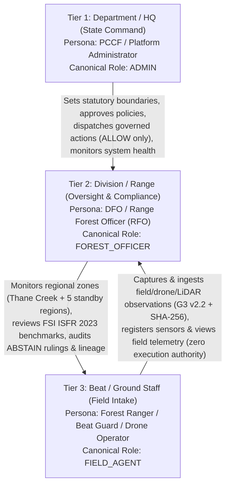

# VANA | Forest Department Operating Scope, Hierarchy & Approved Role-Permission Matrix

**Document Reference:** `BHIV-VANA-PROD-RBAC-2026-11`  
**Owner:** Kaushal Yadav (Product & Forest Department Workflow Owner, BHIV)  
**Target Repository:** `finalvana-main`  
**Status:** Frozen Product Baseline (EOD Release Scope)  
**Downstream Consumers:** Pritesh Patra (Backend & Deployment), Rhugved Chavan (Frontend & Role Experience), Pratik Bhuvad (Integration Assurance & QA)

---

## 1. Frozen Forest Department Operating Scope

### 1.1 Product Mandate
VANA (Environmental Governance Monitoring System) provides the **Maharashtra Forest Department** with a unified, role-based, fail-closed operational platform that connects field sensor/drone observations (**G3**) through canonical MasterDB persistence (**G1**), scientific context evaluation (**G2**), governed workflow execution or explicit abstention (**G4 / SANSKAR**), and transparent audit lineage & geospatial oversight (**G5**), aligned with **BIQOS** constitutional boundaries.

### 1.2 Explicitly In-Scope (Frozen for EOD Release)
1. **3-Tier Role-Based Access Control (RBAC):** Predefined, least-privilege operational experiences for **Admin (Department / HQ)**, **Forest Officer (Division / Range)**, and **Field Agent (Beat / Ground Staff)** with closed registration (`POST /auth/register` strictly returns `403 Forbidden`).
2. **Observation-to-Governed-Outcome 5-Group Pipeline (G1–G5):**
   - Field/sensor observation intake validated against frozen Group 3 schema `v2.2` (`observation.schema.v2.2.json`) with mandatory timestamp, source identity, geospatial coordinates, and SHA-256 raw artifact integrity checksum.
   - Canonical persistence (`CR-<uuid>`) in Group 1 MasterDB with SHA-256 idempotency protection (`201 Created`, `200 Idempotent Replay`, `409 Idempotency Conflict`, `400 Validation Rejected`).
   - Group 2 scientific context resolution with strict fail-closed `ABSTAIN` when calibration, timestamp, provenance, or authoritative context is missing or unverified.
   - Group 4 governed execution gate enforcing `decision_action: "noop"` on `ABSTAIN`, and allowing `dispatch` **only** when authorized by both governance ruling (`ALLOW`) and an authenticated `ADMIN` with `EXECUTE_WORKFLOW`.
   - Group 5 operational dashboard showing canonical IDs, actual upstream states (`pending`, `missing`, `rejected`, `ABSTAIN`), geospatial zone coverage (Thane Creek active + 5 regional standby zones clearly labeled), FSI ISFR 2023 statutory forest cover benchmarks (`50,858.53 km²`, `315.09 km²` mangrove), and deterministic lineage/replay verification.
3. **BIQOS Pairing Contract Alignment:** Verified authority separation (`TMS`, `GC`, `MDU`, `MASTERDB`, `Bucket`, `TANTRA`, `InsightFlow / Pravah`), honest status tagging for upstream BIQOS dependencies (`BLOCKED` where upstream gates remain open — never claimed complete without live proof), and zero modification to external BIQOS/TANTRA repositories.

### 1.3 Explicitly Out-of-Scope / Non-Goals
- No public self-registration or client-side role switching (`DEV_MODE` remains permanently `false`).
- No unrelated features, shadow capability registries, or parallel BIQOS/TANTRA execution engines.
- No governance bypasses (zero unauthorized workflow dispatches; zero silent fallback timestamps or invented `context_id` values).
- No silent schema, credential, or semantic changes without logged decision records and migration notes.
- No fabricated metrics, mock coordinates, or hardcoded "live" audit events presented as real-time telemetry.

---

## 2. Forest Department 3-Tier Operating Hierarchy

VANA maps directly to the statutory administrative hierarchy of the Forest Department:

### Operational Scope & Authority Boundaries by Tier

| Tier | Department Level | Operational Persona | Canonical Role | What This Role OWNS | What This Role Is STRICTLY PROHIBITED From |
| :---: | :--- | :--- | :--- | :--- | :--- |
| **Tier 1** | **Department / HQ** | PCCF / Platform Administrator | `ADMIN` | Platform health & service readiness, governance policy configuration, RBAC/access oversight, statutory benchmark ingestion (`POST /official/forest-cover`), and authorized workflow dispatch (`POST /vana/execute` on `ALLOW` rulings only). | Cannot bypass fail-closed `ABSTAIN` rulings into `dispatch` without authoritative context; cannot forge observation provenance or alter raw artifact SHA-256 hashes. |
| **Tier 2** | **Division / Range** | Divisional / Range Forest Officer (DFO / RFO) | `FOREST_OFFICER` | Regional monitoring oversight (Thane Creek live + Konkan, Western Ghats, Marathwada, Vidarbha, Desh standby), FSI ISFR 2023 statutory benchmark reconciliation, reviewing Group 2 `ABSTAIN`/`ALLOW` decisions, inspecting audit logs, and running deterministic lineage replay. | Cannot dispatch governed executions (`POST /vana/execute` → `403`); cannot modify system/map/policy configs or manage users; cannot mutate raw field observations. |
| **Tier 3** | **Beat / Ground Staff** | Beat Officer / Field Ranger / Edge Operator | `FIELD_AGENT` | Submitting validated field/drone/LiDAR observations (`POST /observations` conforming to Group 3 v2.2), sensor intake & registration, viewing operational map, alerts, telemetry, and lineage status of submitted records. | Cannot dispatch governed executions (`POST /vana/execute` → `403`); cannot ingest/alter statutory FSI benchmarks; cannot access Admin Control Plane (`admin.html`), governance policy controls, or user management. |

---

## 3. Approved Identity & Credential Configuration Policy (Zero-Secret Standard)

Per the release security and non-silent-change rules:
1. **No Secrets Committed or Exposed:** Production credentials must be injected exclusively via environment variables (`VANA_ADMIN_EMAIL`, `VANA_ADMIN_PASSWORD`, `VANA_FOREST_EMAIL`, `VANA_FOREST_PASSWORD`, `VANA_FIELD_EMAIL`, `VANA_FIELD_PASSWORD`) and hashed via `bcrypt` in MasterDB (`backend/auth_service.py`).
2. **Closed Account Registration:** `POST /auth/register` is permanently disabled (`HTTP 403 Forbidden`) at both backend (`unified_auth_runtime.py`) and gateway (`server.py`).
3. **Tracked Non-Silent Naming Decision (`DEC-VANA-01` — Field Agent Default Email):**
   - Current local default in `backend/auth_service.py:103` is `feild@gmail.com` (spelling typo).
   - **Rule Applied (No Silent Breaking Changes):** To avoid breaking Pratik's and Rhugved's existing EOD verification tests (`test_auth_integration.js`, E2E scripts), `feild@gmail.com` remains explicitly documented for the **EOD Demonstration** build while `VANA_FIELD_EMAIL` env override is used on deployed environments.
   - **Production Candidate Action:** Pritesh Patra to support `field@gmail.com` as the canonical default (with documented migration note) and remove the dead legacy `USERS` dictionary (`admin@vana.gov.in`, `participant@vana.gov.in`, etc.) in `unified_auth_runtime.py:47-109` and stale printout in `start_local.py:92-96`.
4. **Backward-Compatibility Role Alias Normalization (`admin-auth.js:50-140`):**
   - Canonical roles are strictly **`ADMIN`**, **`FOREST_OFFICER`**, and **`FIELD_AGENT`**.
   - Legacy aliases (`PLATFORM_ADMIN` → `ADMIN`; `AUDITOR`, `GOVERNANCE_STEWARD`, `JUDGE`, `STEWARD` → `FOREST_OFFICER`; `APPROVED_CONSUMER`, `PARTICIPANT`, `OPERATOR`, `VIEWER` → `FIELD_AGENT`) are normalized strictly read-only for backward compatibility and must not introduce extra privilege tiers.

---

## 4. Approved Role & Permission Matrix (Canonical Authority Table)

This matrix reconciles `backend/auth_service.py` (`ROLE_PERMISSIONS`), `frontend/.../admin-auth.js` (`PERMISSIONS`), and all G1–G5 capabilities.

| Permission Key | Description | `ADMIN` (Dept / HQ) | `FOREST_OFFICER` (Div / Range) | `FIELD_AGENT` (Beat / Ground) | Enforcement Layer & Sync Status |
| :--- | :--- | :---: | :---: | :---: | :--- |
| `VIEW_DASHBOARD` | View Command Center Overview (`overviewView`) | **ALLOW** | **ALLOW** | **ALLOW** | Backend + Frontend (**Synced**) |
| `VIEW_MAP` | View Spatial Intelligence Map (`mapView`) | **ALLOW** | **ALLOW** | **ALLOW** | Backend + Frontend (**Synced**) |
| `VIEW_ALERTS` | View Governance Notices & Declared Gaps | **ALLOW** | **ALLOW** | **ALLOW** | Backend + Frontend (**Synced**) |
| `VIEW_LINEAGE` | View 4-Tier Audit Lineage Rail (`G3→G1→G2→G4`) | **ALLOW** | **ALLOW** | **ALLOW** | Backend + Frontend (**Synced**) |
| `SUBMIT_OBSERVATION` | Submit field/sensor observation (`POST /observations`) | **DENY** *(or Admin override only if explicitly scoped)*¹ | **DENY** | **ALLOW** | **Action Needed:** Add to `admin-auth.js` & enforce Bearer RBAC on G1 `POST /observations` (`BLK-VANA-03`) |
| `INTAKE_SENSOR_DATA` | Push Group 3 v2.2 sensor telemetry payloads | **DENY** | **DENY** | **ALLOW** | **Action Needed:** Add constant to `admin-auth.js` |
| `REGISTER_SENSOR` | Register edge sensor / drone station metadata | **ALLOW** *(via config)* | **DENY** | **ALLOW** | **Action Needed:** Add constant to `admin-auth.js` |
| `VIEW_TELEMETRY` | Inspect Sensor Intake & Telemetry Feeds (`monitoringView`, `fieldOps`) | **ALLOW** *(via dashboard)* | **ALLOW** *(read-only)* | **ALLOW** | **Action Needed:** Add constant to `admin-auth.js` |
| `VIEW_FOREST_COVER` | Query FSI ISFR 2023 statutory forest cover datasets | **ALLOW** *(via dashboard)* | **ALLOW** | **DENY** | **Action Needed:** Add constant to `admin-auth.js` & restore UI tab (`DEF-02`) |
| `VIEW_STATUTORY_BENCHMARKS` | Inspect statutory compliance vs live observations (`analyticsView`) | **ALLOW** *(via dashboard)* | **ALLOW** | **DENY** | **Action Needed:** Add constant to `admin-auth.js` & restore `#subtabForestCover` (`DEF-02`) |
| `VIEW_GOVERNANCE_DECISIONS` | Inspect Group 2 Pravah rulings (`ABSTAIN` / `ALLOW`) (`decisionsView`) | **ALLOW** *(via policies)* | **ALLOW** | **DENY** *(summary only)* | **Action Needed:** Add constant to `admin-auth.js` |
| `VIEW_EVIDENCE` | Inspect raw artifact provenance & SHA-256 checksums | **ALLOW** | **ALLOW** | **DENY** *(own intake receipt only)* | Backend + Frontend (**Synced**) |
| `RUN_REPLAY` | Execute deterministic lineage & invariant replay diff (`historyView`) | **ALLOW** | **ALLOW** | **DENY** | Backend + Frontend (**Synced**) |
| `VIEW_AUDIT_LOG` | Inspect immutable governance & system audit logs | **ALLOW** | **ALLOW** | **DENY** | Backend + Frontend (**Synced**) |
| `ACKNOWLEDGE_ALERT` | Acknowledge operational alerts & governance notices | **ALLOW** | **DENY** | **DENY** | Backend + Frontend (**Synced**) |
| `EXECUTE_WORKFLOW` | Dispatch governed workflow via `POST /vana/execute` (only on `ALLOW`) | **ALLOW** | **DENY (`403`)** | **DENY (`403`)** | Enforced on G4 `POST /vana/execute` (**Verified**) |
| `DISPATCH_EXECUTION` | Trigger SANSKAR governed execution hand-off | **ALLOW** | **DENY (`403`)** | **DENY (`403`)** | **Action Needed:** Add constant to `admin-auth.js` |
| `RUN_HEALTH_CHECK` | Probe G1/G2/G4 service health & latency (`admin.html`) | **ALLOW** | **DENY** | **DENY** | **Action Needed:** Add constant to `admin-auth.js` |
| `VIEW_SERVICES` | View backend microservice status & topology (`admin.html`) | **ALLOW** | **DENY** | **DENY** | **Action Needed:** Add constant to `admin-auth.js` |
| `VIEW_POLICIES` | View active governance invariants & statutory rules (`admin.html`) | **ALLOW** | **DENY** | **DENY** | **Action Needed:** Add constant to `admin-auth.js` |
| `EDIT_GEO_CONFIG` | Modify surveillance zone GIS configuration | **ALLOW** | **DENY** | **DENY** | **Action Needed:** Add constant to `admin-auth.js` |
| `MANAGE_USERS` | Manage authorized Forest Dept user accounts (`admin.html`) | **ALLOW** | **DENY** | **DENY** | UI explicitly marked `Unavailable` (awaiting directory API) |
| `MANAGE_ROLES` | Manage role mappings & least-privilege policies | **ALLOW** | **DENY** | **DENY** | Backend + Frontend (**Synced**) |
| `MANAGE_MAP_CONFIG` | Configure regional surveillance zones & layers | **ALLOW** | **DENY** | **DENY** | Backend + Frontend (**Synced**) |
| `MANAGE_ALERT_RULES` | Configure exception thresholds & alert triggers | **ALLOW** | **DENY** | **DENY** | Backend + Frontend (**Synced**) |
| `MANAGE_GOVERNANCE_POLICIES` | Manage fail-closed governance policy references | **ALLOW** | **DENY** | **DENY** | Backend + Frontend (**Synced**) |
| `MANAGE_SYSTEM_CONFIG` | Manage platform environment & gateway configuration | **ALLOW** | **DENY** | **DENY** | Backend + Frontend (**Synced**) |

> ¹ **Separation-of-Duty Note:** Under strict least-privilege governance, field observation ingestion (`SUBMIT_OBSERVATION`) belongs to `FIELD_AGENT`, while statutory benchmark ingestion (`POST /official/forest-cover`) and workflow execution (`EXECUTE_WORKFLOW`) belong strictly to `ADMIN`.

---

## 5. Endpoint-by-Endpoint & UI Surface Access Matrix (G1–G5)

### 5.1 Backend API Enforcement Matrix

| Group | Endpoint | Method | Public / Unauth | `FIELD_AGENT` | `FOREST_OFFICER` | `ADMIN` | Current Code Status vs Required Spec |
| :---: | :--- | :---: | :---: | :---: | :---: | :---: | :--- |
| **Auth** | `/auth/login` | `POST` | **ALLOW** | **ALLOW** | **ALLOW** | **ALLOW** | **Compliant** (`bcrypt` + role check + rate limit) |
| **Auth** | `/auth/me` | `GET` | **401** | **ALLOW** | **ALLOW** | **ALLOW** | **Compliant** (fail-closed token check) |
| **Auth** | `/auth/logout` | `POST` | **401 / No-op** | **ALLOW** | **ALLOW** | **ALLOW** | **Compliant** (revokes session token) |
| **Auth** | `/auth/register` | `POST` | **403** | **403** | **403** | **403** | **Compliant** (permanently disabled) |
| **G1** | `/health` | `GET` | **ALLOW** | **ALLOW** | **ALLOW** | **ALLOW** | **Compliant** (health/readiness probe) |
| **G1** | `/dashboard/summary` | `GET` | **401** *(Target)* | **ALLOW** | **ALLOW** | **ALLOW** | **Gap (`BLK-VANA-01`):** Currently public & contains hardcoded KPI/audit fields |
| **G1** | `/observations` | `POST` | **401** *(Target)* | **ALLOW** | **403** *(Target)* | **403 / Admin Ingestion** | **Gap (`BLK-VANA-03`):** Currently unauthenticated in `api/main.py:287` |
| **G1** | `/observations/{id}` | `GET` | **401** *(Target)* | **ALLOW** | **ALLOW** | **ALLOW** | **Gap:** Currently public; acceptable for internal read during demo, must require auth for Production Candidate |
| **G1** | `/official/forest-cover` | `POST` | **401** *(Target)* | **403** *(Target)* | **403** *(Target)* | **ALLOW** | **Gap (`BLK-VANA-03`):** Currently unauthenticated in `api/main.py:256` |
| **G1** | `/official/forest-cover/{id}` | `GET` | **401** *(Target)* | **403** *(Target)* | **ALLOW** | **ALLOW** | Statutory benchmark read |
| **G1** | `/datasets/{id}/forest-cover` | `GET` | **401** *(Target)* | **403** *(Target)* | **ALLOW** | **ALLOW** | Statutory dataset listing |
| **G2** | `/api/group2/context/resolve` | `POST` | **401** *(Target)* | **ALLOW** *(pipeline)* | **ALLOW** | **ALLOW** | Fail-closed `ABSTAIN` implemented in `group2Context.js` |
| **G4** | `/vana/execute` | `POST` | **401** | **403** | **403** | **ALLOW** *(enforces `noop` on `ABSTAIN`)* | **Auth Compliant**; persistence & server-side ruling validation needed (`BLK-VANA-02`) |

### 5.2 Frontend UI Navigation Access Matrix (`index.html` & `admin.html`)

| UI Surface / Tab ID | Label in Control Center | `FIELD_AGENT` | `FOREST_OFFICER` | `ADMIN` | Required State Visibility |
| :--- | :--- | :---: | :---: | :---: | :--- |
| `login.html` | Sign In Portal | Entry | Entry | Entry | Predefined role selector; zero public signup link |
| `navItemOverview` (`overviewView`) | Command Center Overview | **Visible** | **Visible** | **Visible** | Live DB KPIs only; explicitly badge `STANDBY` / `UNAVAILABLE` if telemetry missing |
| `navItemMap` (`mapView`) | Spatial Intelligence Map | **Visible** | **Visible** | **Visible** | Thane Creek active marker + 5 zones explicitly labeled `PENDING / STANDBY` |
| `navItemMonitoring` (`monitoringView`) | Sensor Intake & Telemetry | **Visible + Submit Modal** | **Visible (Read-Only)** | **Visible (Read-Only)** | Requires `#btnOpenSubmitObsModal` restored (`DEF-02`) for `FIELD_AGENT` |
| `navItemFieldOps` (`fieldOps`) | Field Operations & Drone Surveillance | **Visible (Primary)** | **Visible (Read-Only)** | **Visible** | Displays hardware intake status & sensor provenance |
| `navItemMasterDB` (`masterdb`) | MasterDB Canonical Records | **Visible (Own / Intake)** | **Visible (Full Read)** | **Visible (Full Read)** | Shows canonical `CR-...` IDs & SHA-256 checksums |
| `navItemDecisions` (`decisionsView`) | Pravah / Niyantran Decision Brain | **Restricted / Summary** | **Visible (Full Audit)** | **Visible + Execute Gate** | Must visibly display `ABSTAIN`, `missing_critical_data`, `noop`, and `abstention_record_id` |
| `navItemAnalytics` (`analyticsView`) | Analytics & Statutory Reports | **Hidden** | **Visible (Primary)** | **Visible** | Requires `#subtabForestCover` & `#btnHistForestCover` restored (`DEF-02`) |
| `navItemHistory` (`historyView`) | History, Lineage & Replay Diff | **Read-Only** | **Visible + Run Replay** | **Visible + Run Replay** | 4-tier rail (`G3→G1→G2→G4`) + 4-invariant replay diff |
| `navItemAdmin` (`admin.html`) | Administration Control Plane | **Hidden / Redirect** | **Hidden / Redirect** | **Visible (Exclusive)** | Live service latency (`/proxy/g1/health`, `/proxy/g4/health`), policy view, explicit `Unavailable` notice on User Directory |

---

## 6. Handover Sign-Off & Action Mapping for Team Members

| Team Member | Immediate Actions Derived From This Frozen Baseline |
| :--- | :--- |
| **Pritesh Patra (Backend & Deployment)** | 1. Enforce Bearer token + RBAC checks on G1 `POST /observations` and `POST /official/forest-cover` (`BLK-VANA-03`). 2. Replace hardcoded `audit_events` / `"ABSTAIN 100%"` / fallback values in `GET /dashboard/summary` with persisted DB state or explicit `PENDING`/`UNAVAILABLE` (`BLK-VANA-01`). 3. Persist G4 `/vana/execute` outcomes (`event_id`, `execution_id`, `abstention_record_id`), verify ruling server-side, and fix `evidence.status` line 228 (`BLK-VANA-02`). 4. Clean dead `USERS` dict in `unified_auth_runtime.py` and update `start_local.py` banner (`BLK-VANA-05`). |
| **Rhugved Chavan (Frontend & Role Experience)** | 1. Restore `#btnOpenSubmitObsModal`, `#btnHistForestCover`, and `#subtabForestCover` in `index.html` (`DEF-02`). 2. Sync all 12 missing `auth_service.py` permission constants into `admin-auth.js` (`PERMISSIONS`). 3. Gate UI navigation and action buttons strictly per Section 5.2. 4. Escape dynamic strings prior to `.innerHTML` insertion (`DEF-03`). |
| **Pratik Bhuvad (Integration Assurance & QA)** | 1. Map executable acceptance tests against Sections 4 & 5 (including `401`/`403` checks on G1 writes once Pritesh lands `BLK-VANA-03`). 2. Validate that zero hardcoded/simulated metrics are presented as live on `/dashboard/summary`. |
