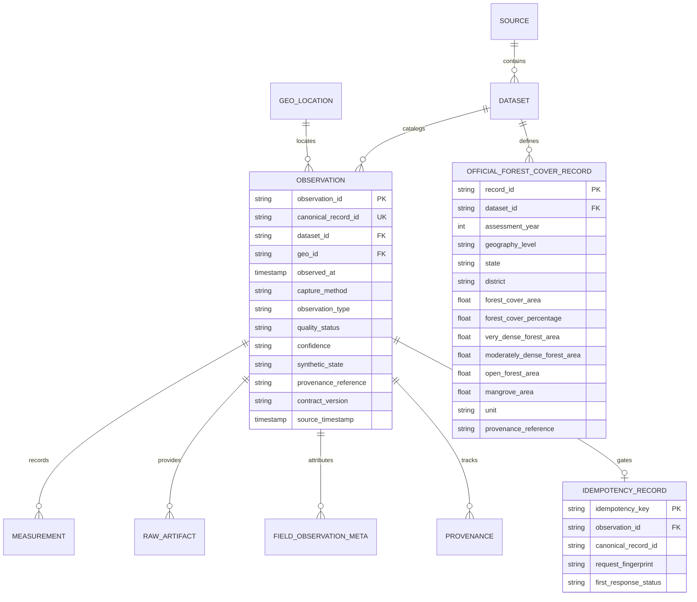

# VANA UI Redesign: Backend Protection & System Integration Map

**Document Phase**: Iteration 0 — Codebase Audit & Backend Protection Inventory  
**Repository**: `PriteshPatra-BHIV/finalvana`  
**Target Frontend**: `frontend/group5-lineage-dashboard/vana-control-center/`  
**Date**: October 2026  
**Auditor**: Antigravity Senior Systems Architect & Security Engineering  
**Status**: ACTIVE — AUTHORITATIVE PROTECTION BASELINE  

---

## 1. Executive Summary & Zero-Regress Mandate

The VANA platform is an autonomous environmental governance and telemetric verification system engineered for the Department of Environment & Climate Change (Government of Maharashtra). It operates across five decoupled subsystems:
- **Group 1**: Foundation & Canonical MasterDB (`backend/group1-masterdb`)
- **Group 2**: Pravah / Niyantran Scientific Context Engine (`backend/group2-pravah-api`, `backend/group4-workflow-runtime/group2Context.js`)
- **Group 3**: Sensor Contracts, Field Ingestion & JSON Schema Specifications (`backend/group3-sensor-contracts`, `observation.schema.json`)
- **Group 4**: SANSKAR Workflow Runtime & Governed Execution Gate (`backend/group4-workflow-runtime`, `/vana/execute`)
- **Group 5**: Operational Surveillance Dashboard & Administration Control Plane (`frontend/group5-lineage-dashboard/vana-control-center/`)

### Strict Protection Doctrine
During the forthcoming UI/UX redesign:
1. **Zero Backend Modifications**: No modifications to backend Python code, FastAPI endpoints, Node.js runtimes, SQL schemas, or database migrations.
2. **Zero Route Alteration**: All API URLs, HTTP methods, headers, parameters, and query shapes must remain byte-for-byte identical.
3. **Zero Proxy Alteration**: Gateway configuration in `server.py` and `vercel.json` must remain intact.
4. **Zero Fabrication**: If an observation timestamp or canonical linkage is missing or pending, the UI must strictly fail closed (render "Assessment Paused / Hold" or "Waiting for Information"); under no circumstances may fake data or fallback values be rendered as live data.
5. **No Mock Data Replacement**: Live backend connections must not be swapped for mock stubs.
6. **Authentication & RBAC Preservation**: Tab-scoped session storage, token verification, permission checks, and role mappings (`PLATFORM_ADMIN`, `AUDITOR`, `GOVERNANCE_STEWARD`, `APPROVED_CONSUMER`) must continue to protect privileged controls.

---

## 2. Existing Backend API Endpoints Inventory

The VANA backend platform exposes 11 active core routes across three backend service groups, reverse-proxied through the gateway on port `8080` (local development) or Vercel edge rewrites (production):

```
Browser Client (:8080)
       │
       ▼
Local Proxy Gateway (server.py:8080) / Production CDN (vercel.json)
       ├── /proxy/auth/*  ──> UNIFIED_BACKEND/auth/* (:8000/auth)
       ├── /proxy/g1/*    ──> VANA_G1_URL (:8013 / MasterDB FastAPI)
       ├── /proxy/g2/*    ──> VANA_G2_URL (https://niyantran.blackholeinfiverse.com)
       └── /proxy/g4/*    ──> VANA_G4_URL (:8010 / SANSKAR Runtime)
```

### Authoritative API Route Catalog

| Endpoint Route | HTTP Method | Owning Subsystem | Gateway Path | Auth Requirement | Status |
| :--- | :--- | :--- | :--- | :--- | :--- |
| `GET /health` | GET | Group 1 MasterDB | `/proxy/g1/health` | None (Public) | Verified Operational |
| `GET /observations/{observation_id}` | GET | Group 1 MasterDB | `/proxy/g1/observations/{id}` | None (Public) | Verified Operational |
| `POST /observations` | POST | Group 1 MasterDB | `/proxy/g1/observations` | Public / Header Key | Verified Operational |
| `GET /datasets/{dataset_id}/forest-cover` | GET | Group 1 MasterDB | `/proxy/g1/datasets/{id}/forest-cover` | None (Public) | Verified Operational |
| `GET /official/forest-cover/{record_id}` | GET | Group 1 MasterDB | `/proxy/g1/official/forest-cover/{id}` | None (Public) | Verified Operational |
| `POST /official/forest-cover` | POST | Group 1 MasterDB | `/proxy/g1/official/forest-cover` | Admin / Steward | Backend-Only / Seed |
| `POST /api/group2/context/resolve` | POST | Group 2 Pravah Context | `/proxy/g2/api/group2/context/resolve` | Forwarded Bearer | Verified Operational |
| `POST /vana/execute` | POST | Group 4 SANSKAR Gate | `/proxy/g4/vana/execute` | Bearer Token (Privileged) | Verified Operational |
| `POST /auth/login` | POST | Central Unified Auth | `/proxy/auth/login` | None (Credentials) | Verified Operational |
| `GET /auth/me` | GET | Central Unified Auth | `/proxy/auth/me` | Bearer Token | Verified Operational |
| `POST /auth/register` | POST | Central Unified Auth | `/proxy/auth/register` | Admin | Verified Contract |

---

## 3. Existing API Request & Response Structures

### 3.1 `GET /observations/{observation_id}`
- **Subsystem**: Group 1 MasterDB (`backend/group1-masterdb/api/main.py:179-206`)
- **Frontend Caller**: `app.js:367` (`fetchLive()`)
- **Path Parameter**: `observation_id` (string, e.g., `TC-Z03-EXT-OPENMETEO-OBS001`)
- **Request Headers**: `Accept: application/json`
- **Response Format (HTTP 200 OK)**:
```json
{
  "trace_id": "VANA-xxxxxxxxxxxx",
  "observation_id": "TC-Z03-EXT-OPENMETEO-OBS001",
  "status": "RETRIEVED",
  "observation": {
    "observation_id": "TC-Z03-EXT-OPENMETEO-OBS001",
    "canonical_record_id": "CR-b4615a27-7ab1-4bde-a078-a56fa0f2414c",
    "dataset_id": "DS-EXTERNAL-API-TC-Z03-F02",
    "geo_id": "GEO-2a74c44b-c408-4680-bc9a-6535d8e75db5",
    "observed_at": "2026-08-25T11:00:00+00:00",
    "observation_timestamp": "2026-08-25T11:00:00+00:00",
    "source_timestamp": "2026-08-25T11:00:00+00:00",
    "capture_method": "external_api",
    "device_id": "EXT-OPENMETEO-API",
    "species": null,
    "observation_type": "precipitation",
    "quality_status": "VALIDATED",
    "confidence": "NOT VERIFIED",
    "synthetic_state": "CONTROLLED",
    "location": {
      "latitude": 19.1288,
      "longitude": 72.9421,
      "altitude_m": 4.0,
      "gnss_status": null,
      "position_accuracy_m": null
    },
    "measurements": [
      {
        "measurement_id": "MEAS-6f9168bf-7c85-48b6-9838-895786ef7170",
        "metric_name": "precipitation",
        "data_type": "NUMERIC",
        "value": 0.1,
        "unit": "mm",
        "method": "external_api_ingest",
        "provenance": {
          "source_id": "SRC-OPENMETEO",
          "run_id": "RUN-SEED-TC-Z03-F02"
        }
      }
    ],
    "raw_artifacts": []
  }
}
```
- **Error Responses**:
  - `HTTP 404 Not Found`: `{"trace_id": "VANA-...", "status": "NOT_FOUND", "message": "Observation was not found.", "errors": []}`

---

### 3.2 `POST /observations`
- **Subsystem**: Group 1 MasterDB (`backend/group1-masterdb/api/main.py:80-177`)
- **Frontend Caller**: `app.js:2339` (`submitObservationPayload()`)
- **Headers**:
  - `Content-Type: application/json`
  - `Accept: application/json`
  - `Idempotency-Key: IK-VANA-...` (optional header for replay control)
- **Request Body Schema (Group 3 v2.2 Contract)**:
```json
{
  "contract_version": "2.2",
  "schema_version": "2.2",
  "observation_id": "TC-Z03-F02-SENSOR-OBS999",
  "source_identity": "group3-field-edge",
  "survey_id": "TC",
  "zone_id": "Z03",
  "flight_id": "F02",
  "sensor_id": "SENSOR",
  "observation_seq": "OBS999",
  "mission_id": "TC-Z03-F02",
  "observation_timestamp": "2026-08-25T10:00:00Z",
  "source_timestamp": "2026-08-25T10:00:00Z",
  "data_state": "CAPTURED",
  "synthetic_state": "CONTROLLED",
  "quality_state": "CAPTURED",
  "calibration_state": "NOT_VERIFIED",
  "device_id": "G3-SENSOR-999",
  "observation_type": "canopy_height",
  "capture_method": "sensor",
  "processing_status": "raw",
  "measurement": 7.8,
  "unit": "m",
  "accuracy": "NOT_VERIFIED",
  "location": {
    "latitude": 19.1288,
    "longitude": 72.9421,
    "altitude_m": 12.5,
    "gnss_status": "NOT_VERIFIED",
    "position_accuracy_m": null
  },
  "raw_artifact": "TC-Z03-F02/sensor/log_999.txt",
  "raw_artifact_integrity": {
    "checksum_sha256": "f7254999689ae5b530a0006d0fb6765df0317973504e8c5d1b393bfa5826cf9d",
    "hash_algorithm": "sha256",
    "artifact_type": "sensor_reading"
  },
  "provenance_reference": "TC-Z03-F02/qa/qa_F02.json",
  "provenance": {
    "device_id": "G3-SENSOR-999",
    "mission_id": "TC-Z03-F02",
    "captured_at": "2026-08-25T10:00:00Z",
    "raw_artifact": "TC-Z03-F02/sensor/log_999.txt",
    "qa_record": "TC-Z03-F02/qa/qa_F02.json"
  }
}
```
- **Response Format (HTTP 201 Created)**:
```json
{
  "trace_id": "VANA-xxxxxxxxxxxx",
  "observation_id": "TC-Z03-F02-SENSOR-OBS999",
  "canonical_record_id": "CR-7f613c29-3712-4fbe-9b33-e991448b11a2",
  "status": "ACCEPTED",
  "message": "Observation persisted through canonical VANA persistence."
}
```
- **Alternative Status Codes**:
  - `HTTP 200 OK`: `{"status": "IDEMPOTENT_REPLAY", "observation_id": "...", "canonical_record_id": "..."}`
  - `HTTP 409 Conflict`: `{"status": "IDEMPOTENCY_CONFLICT", "message": "Idempotency-Key was already used with a different request payload."}`
  - `HTTP 400 Bad Request`: `{"status": "REJECTED", "message": "Observation failed Group 3 contract validation.", "errors": [...]}`

---

### 3.3 `GET /datasets/{dataset_id}/forest-cover`
- **Subsystem**: Group 1 MasterDB (`backend/group1-masterdb/api/main.py:75-77`)
- **Frontend Caller**: `app.js:1979` (`loadOfficialForestCover()`)
- **Path Parameter**: `dataset_id = "DS-FSI-ISFR-2023-FOREST-COVER"`
- **Response Format (HTTP 200 OK)**:
```json
{
  "dataset_id": "DS-FSI-ISFR-2023-FOREST-COVER",
  "records": [
    {
      "record_id": "FC-9e602eff084ffc653d5bab7e0cfc6c52",
      "dataset_id": "DS-FSI-ISFR-2023-FOREST-COVER",
      "dataset_name": "India State of Forest Report 2023 Forest Cover",
      "state": "Maharashtra",
      "district": null,
      "assessment_year": 2023,
      "geography_level": "STATE",
      "boundary_reference": "Recorded Forest Area (RFA) boundary provided by Maharashtra State Forest Department",
      "forest_cover_area": 50858.53,
      "forest_cover_percentage": 16.53,
      "very_dense_forest_area": 9538.99,
      "moderately_dense_forest_area": 15827.39,
      "open_forest_area": 10744.55,
      "mangrove_area": 315.09,
      "unit": "km2",
      "quality_status": "EXTRACTED",
      "methodology": "Multi-date satellite data (LISS-III, Resourcesat-2, 23.5m resolution)",
      "provenance_reference": "ISFR-2023/Chapter-2/Table-2.4",
      "source": {
        "source_id": "SRC-FSI-ISFR-2023",
        "source_name": "India State of Forest Report 2023",
        "publisher": "Forest Survey of India, Ministry of Environment, Forest and Climate Change",
        "source_url": "https://fsi.nic.in/isfr-2023",
        "citation": "Forest Survey of India (2023). India State of Forest Report 2023."
      }
    }
  ]
}
```

---

### 3.4 `POST /api/group2/context/resolve`
- **Subsystem**: Group 2 Pravah Scientific Context (`backend/group4-workflow-runtime/group2Context.js:30`)
- **Frontend Caller**: `app.js:443` (`fetchLive()`)
- **Request Body**:
```json
{
  "observation_id": "TC-Z03-EXT-OPENMETEO-OBS001"
}
```
- **Response Format (HTTP 200 OK, Governed ABSTAIN Decision)**:
```json
{
  "observation_id": "TC-Z03-EXT-OPENMETEO-OBS001",
  "canonical_record_id": "CR-b4615a27-7ab1-4bde-a078-a56fa0f2414c",
  "context_id": null,
  "ruling": "ABSTAIN",
  "action_eligibility": false,
  "abstention_required": true,
  "action_request": null,
  "evidence": {
    "source": "Open-Meteo.com",
    "confidence": "NOT VERIFIED",
    "missing_critical_data": "TIMESTAMP",
    "provenance_reference": "TC-Z03-EXT-OPENMETEO/provenance.json",
    "artifact_hash": null,
    "artifact_type": null,
    "observation_timestamp": "2026-08-25T11:00:00.000Z",
    "retrieval_timestamp": null,
    "attribution": null,
    "canonical_observation_location": {
      "latitude": 19.1288,
      "longitude": 72.9421,
      "altitude_m": 4.0
    }
  },
  "provenance": {
    "group2_decision_time": "2026-10-30T10:00:00.000Z",
    "reason": "MISSING_SOURCE_TIMESTAMP",
    "message": "Authoritative evidence threshold not met (Missing source timestamp). Failing closed to ABSTAIN."
  }
}
```

---

### 3.5 `POST /vana/execute`
- **Subsystem**: Group 4 SANSKAR Workflow Runtime Gate (`/vana/execute`)
- **Frontend Caller**: `app.js:534` (`fetchLive()`)
- **Request Headers**:
  - `Content-Type: application/json`
  - `Authorization: Bearer <access_token>`
- **Request Body**:
```json
{
  "observation_id": "TC-Z03-EXT-OPENMETEO-OBS001",
  "canonical_record_id": "CR-b4615a27-7ab1-4bde-a078-a56fa0f2414c",
  "context_id": null,
  "ruling": "ABSTAIN",
  "action_eligibility": false,
  "abstention_required": true,
  "action_request": null
}
```
- **Response Format (HTTP 200 OK, Governed Abstention)**:
```json
{
  "success": true,
  "action": "noop",
  "status": "governed_abstention",
  "evidence": {
    "event_type": "GOVERNED_ABSTENTION",
    "ruling": "ABSTAIN",
    "decision_action": "noop",
    "abstention_record_id": "abstention-11089633acb9d2cd8c0c673a",
    "event_id": "8a1d93f8-e7fe-49c2-a828-291b88e2758b",
    "execution_id": "exec-abstention-7e75f88f06e84cb6",
    "governance_allowed": true,
    "recorded_at": "2026-10-30T10:00:01.000Z",
    "decision_reason": "Governed abstention enforced: ruling is ABSTAIN and decision_action is noop. No operational action taken."
  }
}
```
- **Alternative Error Codes**:
  - `HTTP 401 Unauthorized`: Authentication token expired or missing. Clears session and prompts sign-in.
  - `HTTP 403 Forbidden`: Authenticated user lacks `EXECUTE_WORKFLOW` permission (e.g. `APPROVED_CONSUMER` role). Fails closed safely.

---

### 3.6 Authentication Routes (`POST /auth/login`, `GET /auth/me`)
- **Frontend Caller**: `admin-auth.js:457` (`login()`), `admin-auth.js:522` (`_fetchMeProfile()`)
- **Login Request**:
```json
{
  "email": "admin@vana.gov.in",
  "password": "••••••••••••"
}
```
- **Login Response (HTTP 200 OK)**:
```json
{
  "access_token": "eyJhbGciOi...",
  "token_type": "bearer",
  "user": {
    "id": "usr-001",
    "email": "admin@vana.gov.in",
    "name": "System Administrator",
    "role": "admin",
    "permissions": [
      "VIEW_DASHBOARD",
      "VIEW_MAP",
      "VIEW_ALERTS",
      "VIEW_LINEAGE",
      "VIEW_EVIDENCE",
      "RUN_REPLAY",
      "VIEW_AUDIT_LOG",
      "MANAGE_USERS",
      "MANAGE_ROLES",
      "MANAGE_SYSTEM_CONFIG",
      "EXECUTE_WORKFLOW"
    ]
  }
}
```

---

## 4. Existing Authentication & RBAC Architecture

### 4.1 Token Lifecycle & Storage Policy
- **Storage**: Tab-scoped `sessionStorage` (`"vana_access_token"`, `"vana_user_profile"`). No passwords or persistent local storage used.
- **Session Restoration**: On page reload, `admin-auth.js:restoreSession()` executes `GET /proxy/auth/me` with the bearer token to verify server validity.
  - `HTTP 200`: Refreshes session profile and sets `isLiveValidated = true`.
  - `HTTP 401`: Token rejected. Clears `sessionStorage` and returns `null`.
  - Network error / 5xx: Preserves token, switches to degraded offline state (`isLiveValidated = false`), and blocks all privileged execution gates.

### 4.2 Role Mapping Matrix

| Raw Backend Role string | Canonical Mapped Role | Display Label | Permissions Granted |
| :--- | :--- | :--- | :--- |
| `admin`, `administrator`, `platform_admin` | `PLATFORM_ADMIN` | Platform Admin | Full Control: View all, run replay, manage config/users, execute workflows (`POST /vana/execute`) |
| `participant`, `consumer`, `approved_consumer`, `operator` | `APPROVED_CONSUMER` | Approved Consumer | Read-Only Monitoring: Overview, Monitoring, Map, Lineage. Strictly blocked from `/vana/execute` (HTTP 403) and Admin Plane. |
| `judge`, `auditor`, `analyst` | `AUDITOR` | Auditor / Judge | Governance Verification: Dashboard, Lineage, Replay Verification (`triggerReplayVerification()`), Admin Session Audit Log. Blocked from `/vana/execute`. |
| `steward`, `governance_steward` | `GOVERNANCE_STEWARD` | Governance Steward | Environmental Stewardship: Dashboard, Map, Lineage, Evidence, Policy Verification. |

---

## 5. Existing Database Schema & Entity Relationships

The Group 1 MasterDB operates across 10 migrations (`0001_init.sql` through `0008_official_forest_cover.sql`) with dual PostgreSQL and SQLite compatibility:



### Table Inventory
1. `schema_version`: Applied migration history.
2. `source`: Master data sources (`SRC-FSI-ISFR-2023`, `SRC-OPENMETEO`).
3. `dataset`: Registered datasets (`DS-FSI-ISFR-2023-FOREST-COVER`, `DS-EXTERNAL-API-TC-Z03-F02`).
4. `geo_location`: Spatial coordinates and altitude.
5. `observation`: Canonical observation master entity.
6. `field_observation_meta`: Hardware telemetry (device ID, mission, calibration, GNSS status).
7. `measurement`: Specific physical values (precipitation 0.1 mm, canopy height 7.8 m).
8. `raw_artifact`: SHA-256 integrity checksums and storage references.
9. `processing_run`: Pipeline execution runs and batch actors.
10. `idempotency_record`: SHA-256 fingerprint deduplication ledger.
11. `provenance`: Cross-group derivation lineage.
12. `official_forest_cover_record`: Statutory government forest benchmarks.

---

## 6. Frontend Pages, Views & Integration Inventory

The current frontend is split across two primary HTML interfaces:

### Page 1: Operational Governance Dashboard (`index.html` + `app.js`)

| View / Tab ID | Purpose | Live Backend Connection | Key Received Fields | Interactive Actions |
| :--- | :--- | :--- | :--- | :--- |
| **Header Controls** | Global navigation, time, health beacon, observation selection | `/proxy/g1/health`<br>`/proxy/auth/me`<br>`/proxy/g1/observations/{id}` | `status`, `user.name`, `user.role`, `observation_id` | • Select pre-seeded observation<br>• Custom ID lookup prompt<br>• Open Submission modal<br>• Refresh live data<br>• Sign in / Sign out |
| **Overview** (`#viewOverview`) | High-level status banner, 4 KPI cards, attention locations, latest readings, activity log | `GET /observations/{id}`<br>`POST /context/resolve`<br>`POST /vana/execute` | `canonical_record_id`, `measurement`, `unit`, `ruling`, `status`, `event_id` | • Filter attention locations (All/Review/Waiting)<br>• Jump to Map<br>• Jump to Decisions |
| **Monitoring** (`#viewMonitoring`) | Regional zone inspection, status cards, 6-zone directory table | `REGIONAL_ZONES` + live observation data | `status`, `lat`, `lon`, `alt_m`, `notes` | • Filter chips (All/Updated/Waiting/Review)<br>• Zone dropdown filter<br>• View on Map |
| **Map & Locations** (`#viewMap`) | Leaflet geospatial view with regional surveillance markers & telemetry strip | `window.VanaGeoEngine` + Leaflet 1.9.4 | `lat`, `lon`, `alt_m`, `status`, `source`, `license` | • Toggle Tile vs. Schematic mode<br>• Zone jump dropdown<br>• Fullscreen toggle<br>• Station click inspection |
| **Reviews & Decisions** (`#viewDecisions`) | 5-step plain-language governance ruling breakdown, role action panel, raw JSON details | `POST /context/resolve`<br>`POST /vana/execute` | `ruling` (ABSTAIN), `decision_action` (noop), `abstention_record_id`, `event_id` | • Authenticated action dispatch<br>• Sign-in modal trigger<br>• Technical JSON payload collapse |
| **History & Evidence** (`#viewHistory`) | Multi-subtab audit center: Lineage rail, replay diff, evidence pack, DOIs, statutory benchmarks | • Subtab 1: Provenance Rail (`provenance`)<br>• Subtab 2: Replay Diff Engine (`triggerReplayVerification()`)<br>• Subtab 3: Raw Evidence Pack (`SOURCE_EVIDENCE_PACK_...json`)<br>• Subtab 4: Scientific DOIs<br>• Subtab 5: `GET /datasets/{id}/forest-cover` | `canonical_record_id`, `trace_id`, `invariants`, `forest_cover_area`, `mangrove_area` | • Subtab switching<br>• Trigger live replay verification (computes 4 invariants)<br>• Query MasterDB benchmarks<br>• External DOI links |
| **Modals** | Observation Submission (`#observationSubmitModal`) & Login (`#dashboardLoginModal`) | `POST /observations`<br>`POST /auth/login` | `canonical_record_id`, `access_token`, `user` | • Quick-fill v2.2 sample fixtures<br>• Generate SHA-256 Idempotency key<br>• Submit payload JSON<br>• User sign-in |

### Page 2: Administration Control Plane (`admin.html` + `admin.js`)

| Section ID | Purpose | Backend Integration | RBAC Guard |
| :--- | :--- | :--- | :--- |
| **System Health** (`#section-system-health`) | Live reachability and latency probing of G1, G2, G4 | `/proxy/g1/health`<br>`/proxy/g2/health`<br>`/proxy/g4/health` | `PLATFORM_ADMIN` |
| **System Services & Config** (`#section-system-services`, `#section-system-config`) | Architecture overview and environment metadata | Local configuration state | `PLATFORM_ADMIN` |
| **Access Control (Users, Roles, Perms)** (`#section-access-users` etc.) | RBAC inspection and directory notices | Declared boundary state: Awaiting directory service | `PLATFORM_ADMIN` |
| **Geospatial (Zones, Layers, Config)** (`#section-geo-zones` etc.) | Zone coordinates and session Mapbox key | Client-side session storage | `PLATFORM_ADMIN` |
| **Governance & Operations** (`#section-gov-policies`, `#section-ops-alerts` etc.) | Fail-closed rules, alert notices, declared gaps | Declared boundary notices | `PLATFORM_ADMIN` |
| **Administrative Activity** (`#section-audit-activity`) | Session-scoped administrative event log | In-memory `_sessionAuditLog` (100 entries) | `PLATFORM_ADMIN`, `AUDITOR` |

---

## 7. Functionality That Must NOT Be Broken During Redesign

The following core behaviors are critical to system compliance and must be strictly maintained:

1. **Fail-Closed Assessment Ordering**:
   - Step 1 (Group 1): Fetches canonical observation. If Group 1 fails or observation does not exist (404), pipeline halts immediately. Group 2 and Group 4 are NOT called.
   - Step 2 (Group 2): If Group 1 succeeds, evaluates context. If timestamp or canonical linkage is absent, returns `ABSTAIN` with `action_eligibility: false`, `abstention_required: true`, and `context_id: null`.
   - Step 3 (Group 4): Evaluates ruling. In strict accordance with fail-closed doctrine, issues `action: "noop"` and persists `governed_abstention` with `abstention_record_id`.
2. **Pinned Canonical Observation Identity**:
   - `observation_id` (e.g. `TC-Z03-EXT-OPENMETEO-OBS001`) in the sticky navigation header must never be replaced by downstream IDs or context hashes.
3. **Statutory Forest Cover Benchmark Display**:
   - `loadOfficialForestCover()` must dynamically query `/proxy/g1/datasets/DS-FSI-ISFR-2023-FOREST-COVER/forest-cover` and display total forest cover (50,858.53 km2) and mangrove area (315.09 km2) directly from live data.
4. **Group 3 v2.2 Observation Ingestion**:
   - `#observationSubmitModal` must send valid JSON payloads to `POST /proxy/g1/observations` with the `Idempotency-Key` header and correctly handle HTTP 201 Created (displaying canonical record ID), HTTP 200 Replay, HTTP 409 Conflict, and HTTP 400 Validation Rejected.
5. **Deterministic Replay Verification & Invariant Checking**:
   - `triggerReplayVerification()` must execute live across runtimes, verify 4 immutable invariants (`observation_id`, `canonical_record_id`, `context_id`, `ruling`), and render a before/after verification diff.
6. **Authentication & RBAC Security Boundary**:
   - `admin-auth.js` must remain the single source of truth for auth tokens and RBAC checks.
   - Unauthorized execution by `APPROVED_CONSUMER` must fail closed with HTTP 403 notice.
7. **Geospatial Regional Transparency**:
   - Thane Creek must remain labeled as live verified.
   - The remaining 5 zones (Mumbai, Navi Mumbai, Vasai, Thane, Maval) must remain labeled as pending upstream edge sensor deployment without fabricating synthetic data.
8. **Automated Integration Test Verification**:
   - The 32/32 tests in `test_auth_integration.js` must continue to pass without error (`node --test test_auth_integration.js`).

---

## 8. Backend-Only & Unavailable Features (Boundary Register)

The UI must not invent interfaces for features that do not exist or are intentionally backend-only:

1. **Official Forest Cover Ingestion (`POST /official/forest-cover`)**:
   - **Classification**: **Backend-only**
   - **Rationale**: Statutory government datasets (FSI ISFR 2023) are ingested via batch CLI scripts (`backend/group1-masterdb/seed_official_forest_cover.py`). No end-user file upload interface is exposed.
2. **User Directory Listing (`GET /auth/users`)**:
   - **Classification**: **Unavailable**
   - **Rationale**: The unified authentication boundary enforces role claims at the token level but does not expose an administrative user listing endpoint. Admin UI renders an honest boundary notice.
3. **Dynamic Alert & Notification Rule Configuration**:
   - **Classification**: **Unavailable**
   - **Rationale**: Dynamic alert rules require a backend alerting service that is not implemented. Admin UI displays honest boundary notices.
4. **Pravah Python Core Integration Boundary (`VANA_PYTHON_CORE/vana_integration.py`)**:
   - **Classification**: **Backend-only**
   - **Rationale**: Internal Python library consumed directly by the Pravah control plane.

---

## 9. File Modification Boundaries for the Redesign

### Files That Must REMAIN UNTOUCHED
Under no circumstances may the redesign modify these files:
- All backend files:
  - `backend/group1-masterdb/**/*` (FastAPI routes, SQLite/Postgres persistence, schemas)
  - `backend/group2-pravah-api/**/*` (Next.js routes, Pravah context adapters)
  - `backend/group3-sensor-contracts/**/*` (JSON Schema specifications, validation scripts)
  - `backend/group4-workflow-runtime/**/*` (SANSKAR execution, Express router, payloads)
  - `backend/legacy-developer-archives/**/*`
- Gateway and server files:
  - `frontend/group5-lineage-dashboard/vana-control-center/server.py`
  - `frontend/group5-lineage-dashboard/vana-control-center/vercel.json`
  - `frontend/group5-lineage-dashboard/vana-control-center/config.js`
- Test suites:
  - `frontend/group5-lineage-dashboard/vana-control-center/test_auth_integration.js`
  - `backend/group1-masterdb/tests/**/*`
- Static evidence assets:
  - `frontend/group5-lineage-dashboard/vana-control-center/SOURCE_EVIDENCE_PACK_EMITTED_TC-Z03-EXT-OPENMETEO-OBS001.json`

### Files Permitted to be Modified During Frontend Redesign
- `frontend/group5-lineage-dashboard/vana-control-center/index.html` (Markup restructure, layout, accessibility)
- `frontend/group5-lineage-dashboard/vana-control-center/styles.css` (Visual system, typography, colors, layout grid, dark mode / theme)
- `frontend/group5-lineage-dashboard/vana-control-center/geospatial.css` (Map styling, marker cards, controls)
- `frontend/group5-lineage-dashboard/vana-control-center/admin.html` (Admin layout and UI components)
- `frontend/group5-lineage-dashboard/vana-control-center/admin.css` (Admin styling)
- `frontend/group5-lineage-dashboard/vana-control-center/app.js` (UI render bindings only; runtime fetch pipelines and logic preserved)
- `frontend/group5-lineage-dashboard/vana-control-center/geospatial.js` (Map presentation and interaction hooks)
- `frontend/group5-lineage-dashboard/vana-control-center/admin.js` (Admin render presentation)
- `frontend/group5-lineage-dashboard/vana-control-center/admin-auth.js` (May only be edited if strictly preserving all exported methods and passing all 32 tests)
